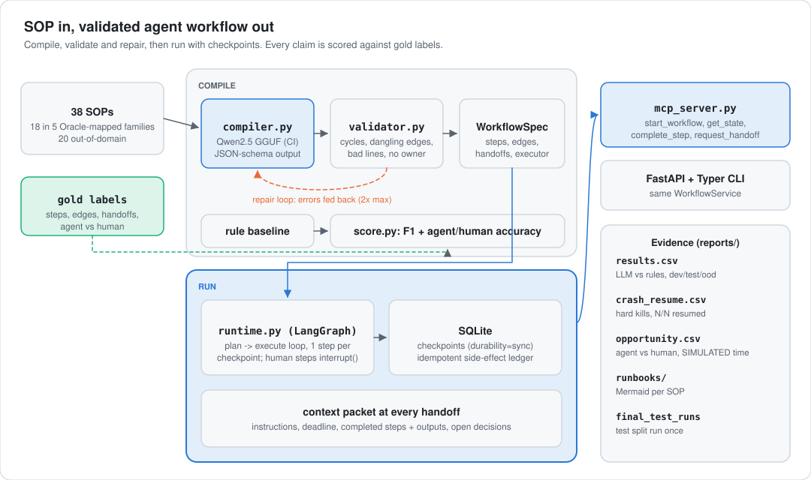

<div align="center">

# SOP-to-Agent Workflow Engine

**Paste a standard operating procedure. Get a validated, state-aware agent workflow with explicit human handoffs, served over MCP, and scored against hand labels.**

[](https://github.com/Jitesh-Mishra/sop-to-agent-workflows/actions/workflows/ci.yml)
[](https://github.com/Jitesh-Mishra/sop-to-agent-workflows/actions/workflows/llm.yml)


| **0.874 vs 0.554** | **0.701 vs 0.548** | **432 of 432** | **13 of 13** |
|:---:|:---:|:---:|:---:|
| step F1, LLM vs rules (13 held-out SOPs) | handoff F1, LLM vs rules | hard-killed runs resumed from checkpoint, 0 duplicate side effects | compiled workflows that are valid DAGs |

</div>

> **What this is and isn't.**
> - 18 public US government procedures (FAR, OPM, NIST, CISA, CMS) and 2 authored support SOPs, grouped into 5 process families. Each family is mapped to an Oracle product area. **These are public templates, not Oracle internal SOPs.**
> - The LLM is open-weights **Qwen2.5-3B** on a CPU runner.
> - Gold labels are **drafts written by Claude**, pending human review (`data/LABELING.md`).
> - Time savings are **SIMULATED** with an assumed time model.

## Why
Business units have SOPs that nobody follows the same way twice. Turning one into an AI workflow means answering four questions:
- What are the steps?
- Who owns each one?
- Which steps can an agent take and which must stay with a person?
- What context has to travel with each handoff?

This project automates that, checks it, and runs it:
- An LLM compiles the SOP into a typed workflow.
- A hand-written validator catches cycles and dead ends and makes the model fix them.
- A LangGraph runtime with SQLite checkpoints executes the workflow and survives crashes.
- Every human handoff carries a context packet.
- MCP tools let any agent drive it.
- Every claim is measured against gold labels, not eyeballed.

## Results

### Compiling SOPs into workflows (test split, run once)

| 13 held-out SOPs in the 5 Oracle-mapped families | Rule baseline | **Qwen2.5-3B, v3** | 95% CI of the difference |
|---|---:|---:|---:|
| Step F1 | 0.554 | **0.874** | +0.11 to +0.57 |
| Edge F1 | 0.218 | **0.529** | +0.06 to +0.55 |
| Handoff F1 | 0.548 | **0.701** | −0.05 to +0.39 |
| Agent vs human accuracy | 0.528 | **0.600** | −0.07 to +0.20 |
| Valid DAG (first try → after repair) | 11 of 13 | **13 of 13 → 13 of 13** | |

<sub>Configuration chosen on a separate dev split and declared in `reports/final_test_runs.json` before the test run. SOP-level bootstrap intervals (`reports/bootstrap_ci.json`); 13 SOPs is small, so handoff and executor gains are not significant. On 14 out-of-domain government SOPs the gap narrows: step F1 0.826 vs 0.736, edge 0.533 vs 0.395, handoff 0.605 vs 0.543, agent vs human 0.689 vs 0.701. All rows are in `reports/results.csv` and `reports/experiments.csv`.</sub>

What the experiments showed (dev split, then confirmed on test):
- **Prompting matters more than size for the 1.5B.** With a one-paragraph prompt it collapsed every SOP into a single step (F1 0). With the rules and one worked example it reached 0.85.
- **The repair loop works because of deterministic fixes, not re-prompting.** At temperature 0 the model often returned the same JSON after seeing its errors. Rule-based fixes (self-handoffs, dangling edges, back edges that close a cycle) took dev validity from 9 of 11 to 11 of 11. The LLM is re-prompted only for what remains.
- **Two tried ideas that were dropped or did not hold:**
  - Re-citing lines by text similarity hurt step F1 (0.88 → 0.79), so it was dropped.
  - A second, focused LLM pass for agent vs human helped on dev (0.55 → 0.65) but **hurt on test** (0.69 → 0.60). It is reported as is.
- **The weak spot is agent vs human.** The 3B flags 103 of 137 compiled steps as agent work; the draft gold labels agree with 54 of them. It over-automates, for example calling a CMS clinical coverage review "information work". This is why every agent flag is a candidate for human review, not a decision.

### State, crashes and handoffs

| 38 workflows, every step on the executed path, process killed with `os._exit(137)` | Resumed correctly | Duplicate side effects |
|---|---:|---:|
| Crash mid-step, before the side effect commits | **216 / 216** | 0 |
| Crash after the commit, before the checkpoint is written | **216 / 216** | 0 |
| Ablation: same, without the idempotency key | 0 / 216 | **216** |
| Ablation: LangGraph default (async) checkpoint durability | 375 / 432 | 0 |

<sub>`python -m sopflow.eval.crash_resume`, about 2.5 min; runs in CI. "Resumed correctly" means the final state (completed steps, outputs, branches taken, handoff packets) equals an uncrashed run's, and every completed step committed exactly once.</sub>

The crash harness found a real bug. With LangGraph's default async durability, a hard kill can leave a latest checkpoint whose pending next node was never written, and the resumed run silently "finishes" with steps missing. Synchronous durability fixed all 432 cases.

## Automation opportunity report

For every family SOP, `docs/opportunities/` lists:
- agent vs human steps, each with the model's reason
- the handoff count
- the riskiest handoff and the context its packet must carry
- simulated cycle and hands-on time

| Family (Oracle area) | Steps (gold) | Agent steps (gold) | Handoffs | Hands-on minutes saved per run, median (SIMULATED) |
|---|---:|---:|---:|---:|
| procure to pay (Oracle Fusion Cloud ERP (Procurement, Payables)) | 21 | 16 | 9 | 48 |
| onboarding (Oracle Fusion Cloud HCM (Onboarding, Benefits)) | 16 | 6 | 6 | 15 |
| incident handling (OCI security operations) | 30 | 15 | 12 | 66 |
| prior authorization (Oracle Health (payer and provider prior authorization)) | 34 | 20 | 24 | 32 |
| support escalation (Oracle Support / Fusion Service) | 14 | 10 | 8 | 51 |
| **All 18 SOPs** | **115** | **67** | **59** | **45** |

<sub>The table uses the gold executor labels, which are the reviewed version of the decision. The same report generated from the LLM's own flags (`reports/opportunity_llm.csv`) claims 103 agent steps and 77 minutes, which is the over-automation above. Time model: an agent-eligible step takes 5 to 30 min by hand today and 2 min of review with an agent. Human steps are unchanged. Paired draws are taken over 200 simulated runs per SOP through the real runtime. These are assumptions, not measurements.</sub>

Example: [prior authorization for hospital outpatient services](docs/opportunities/llm/pa_opd_prior_authorization.md) (Oracle Health).
- The riskiest handoff is the affirmation decision sent to the provider: it has a 7-day deadline, it leaves the organisation, and it has two open branches downstream. Its packet carries the source text, the deadline, completed steps and the next steps.
- The same page shows the model marking all 7 steps as agent work. Only 2 hold up against the gold labels.

Each SOP also gets a runbook with a Mermaid flowchart ([example](docs/runbooks/inc_nist_incident_handling.md)).

## How it works

<picture>
  <source media="(prefers-color-scheme: dark)" srcset="docs/img/architecture-dark.svg">
  
</picture>

1. **Compile** (`sopflow/compiler.py`): the SOP goes to the LLM as numbered lines. The model returns a `WorkflowSpec` with:
   - steps that cite the lines they come from, an owner role, and a handoff recipient
   - **executor**: agent or human, with a one-line reason
   - edges with branch conditions

   The output is constrained to the JSON schema by a llama.cpp grammar. Prompt v2 carries the rules and the agent-vs-human policy. A second, focused pass then classifies each step as agent or human on its own.
2. **Validate and repair** (`sopflow/validator.py`, `sopflow/graph.py`): hand-written cycle detection, topological sort and reachability, plus checks for dangling edges, missing lines, missing owners and self-handoffs. Mechanical errors are fixed deterministically (`postprocess.py`). Anything left is fed back to the LLM as plain sentences, up to 2 times.
3. **Score** (`sopflow/eval/score.py`): predicted steps are matched to gold steps by the lines they cite (Jaccard >= 0.5, Hungarian matching). The scorer reports step, edge and handoff F1 plus agent-vs-human accuracy, with the same scorer for the rule baseline.
4. **Run** (`sopflow/runtime.py`): a LangGraph loop (`plan -> execute`) that gives every SOP step its own SQLite checkpoint.
   - Human steps pause with `interrupt()` and a **context packet**: instructions, deadline, completed steps and their outputs, open decisions, next steps.
   - Agent steps run and hand off with the same packet.
   - Side effects go through an idempotent ledger.
5. **Serve** (`sopflow/mcp_server.py`, `api.py`, `cli.py`): MCP tools `start_workflow`, `get_state`, `complete_step` and `request_handoff` (plus `list_workflows`), served by the official MCP Python SDK. The same operations are available over FastAPI and a Typer CLI. Tests drive every MCP tool through a real MCP client.
6. **Report** (`sopflow/eval/opportunity.py`, `sopflow/runbook.py`): an automation opportunity report and a Mermaid runbook for each SOP.

**Where the LLM runs.** Hosted LLM APIs and Hugging Face are blocked from the build sandbox. So `.github/workflows/llm.yml` downloads the official Qwen2.5 GGUF from Hugging Face on a GitHub runner, runs it on CPU with llama.cpp, and commits every raw attempt to the [`llm-runs`](https://github.com/Jitesh-Mishra/sop-to-agent-workflows/tree/llm-runs) branch. Scoring is offline and deterministic.

## Run it

```bash
pip install -r requirements.txt
pytest -q                                   # tests: graph algorithms, validator, scorer, repair loop, crash/resume, MCP client, REST
python -m sopflow.eval.crash_resume         # hard-kill crash harness on all 38 workflows (about 2.5 min)
scripts/pull_runs.sh && python -m sopflow.eval.report    # score the committed LLM outputs + rule baseline
python -m sopflow.eval.opportunity --specs reports/specs # automation opportunity report (SIMULATED time)

python -m sopflow.mcp_server                # MCP over stdio (add to Claude Desktop or any MCP client)
uvicorn sopflow.api:app --port 8000         # REST; or: docker build -t sopflow . && docker run -p 8000:8000 sopflow
python -m sopflow.cli start onb_form_i9_verification
```

To re-run the LLM, open Actions, choose **LLM eval**, and set task `dev|test|test_ood`, model `1.5b|3b` and prompts `v3`.

## Limitations
- **Gold labels are drafts by Claude**, not yet reviewed by a person. The agent-vs-human policy in the labels is the same one given to the model.
- **Small test set.** 13 family SOPs and 14 out-of-domain. Handoff and executor gains have intervals that include zero.
- **A 3B model on CPU.** About 2.5 min per SOP, and it over-automates. A larger hosted model is the obvious next run; the `GroqBackend` exists, but no numbers are claimed for it.
- **SOP text** is excerpted and lightly condensed from regulations. Real SOPs are messier: tables, forms, scanned PDFs.
- **Executors are simulated.** Agent steps record a completion; nothing calls Oracle or any other real system.
- **Time savings are simulated** with assumed times.

## Next
- Jitesh reviews the gold labels.
- Run a larger model (Groq) through the same harness.
- Make agent vs human a calibrated, abstaining classifier ("unsure" goes to a person).
- Replace simulated executors with real tool calls (email, ticketing).
- Add OCI Generative AI and Autonomous Database backends.

---
<sub>**Stack:** Python, LangGraph, LLMs (Qwen2.5 via llama.cpp), MCP (Model Context Protocol, official Python SDK), FastAPI, REST APIs, SQLite, Git, GitHub Actions, pytest, Docker, CLI (Typer). **Data:** US government works (public domain), sources in each `data/sops/*.md`. **Decisions:** [`docs/decisions.md`](docs/decisions.md). **Interview prep:** [`docs/probe-prep.md`](docs/probe-prep.md).</sub>
