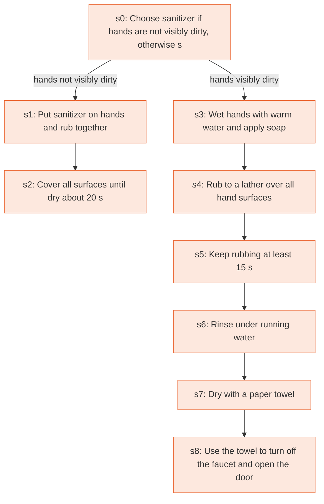

# Runbook: How to clean hands (patients and visitors in healthcare settings)

Source: CDC, About Hand Hygiene for Patients in Healthcare Settings, https://www.cdc.gov/clean-hands/about/hand-hygiene-for-healthcare.html

Generated from the `gold` workflow spec. Rounded boxes are agent steps, square boxes are human steps.

| Step | Action | Owner | Executor | Hands to | Deadline | Source lines |
|---|---|---|---|---|---|---|
| s0 | Choose sanitizer if hands are not visibly dirty, otherwise soap and water | person | human |  |  | L1 |
| s1 | Put sanitizer on hands and rub together | person | human |  |  | L2 |
| s2 | Cover all surfaces until dry (about 20 s) | person | human |  |  | L3 |
| s3 | Wet hands with warm water and apply soap | person | human |  |  | L4 |
| s4 | Rub to a lather over all hand surfaces | person | human |  |  | L5 |
| s5 | Keep rubbing at least 15 s | person | human |  |  | L6 |
| s6 | Rinse under running water | person | human |  |  | L7 |
| s7 | Dry with a paper towel | person | human |  |  | L8 |
| s8 | Use the towel to turn off the faucet and open the door | person | human |  |  | L9 |

## Handoffs

- none
