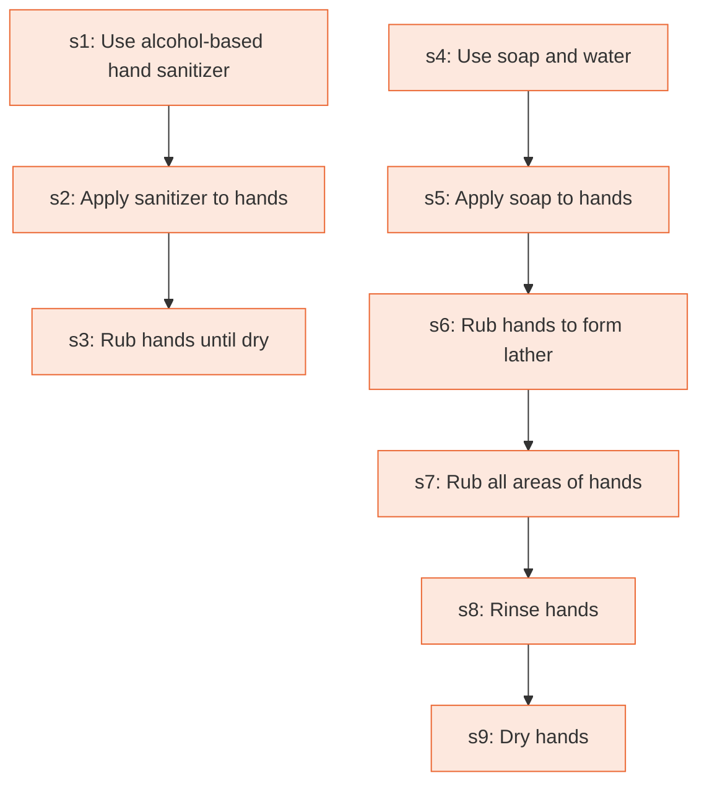

# Runbook: How to clean hands (patients and visitors in healthcare settings)

Source: CDC, About Hand Hygiene for Patients in Healthcare Settings, https://www.cdc.gov/clean-hands/about/hand-hygiene-for-healthcare.html

Generated from the `LLM-compiled` workflow spec. Rounded boxes are agent steps, square boxes are human steps.

| Step | Action | Owner | Executor | Hands to | Deadline | Source lines |
|---|---|---|---|---|---|---|
| s1 | Use alcohol-based hand sanitizer | patients and visitors | human |  |  | L1 |
| s2 | Apply sanitizer to hands | patients and visitors | human |  |  | L2 |
| s3 | Rub hands until dry | patients and visitors | human |  |  | L3 |
| s4 | Use soap and water | patients and visitors | human |  |  | L4 |
| s5 | Apply soap to hands | patients and visitors | human |  |  | L5 |
| s6 | Rub hands to form lather | patients and visitors | human |  |  | L6 |
| s7 | Rub all areas of hands | patients and visitors | human |  |  | L7 |
| s8 | Rinse hands | patients and visitors | human |  |  | L8 |
| s9 | Dry hands | patients and visitors | human |  |  | L9 |

## Handoffs

- none
