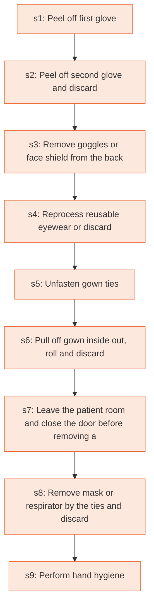

# Runbook: How to safely remove personal protective equipment (PPE), example 1

Source: CDC, How to Safely Remove PPE (CS250672-E), https://www.cdc.gov/hai/pdfs/ppe/ppe-sequence.pdf

Generated from the `gold` workflow spec. Rounded boxes are agent steps, square boxes are human steps.

| Step | Action | Owner | Executor | Hands to | Deadline | Source lines |
|---|---|---|---|---|---|---|
| s1 | Peel off first glove | healthcare worker | human |  |  | L2 |
| s2 | Peel off second glove and discard | healthcare worker | human |  |  | L3 |
| s3 | Remove goggles or face shield from the back | healthcare worker | human |  |  | L4 |
| s4 | Reprocess reusable eyewear or discard | healthcare worker | human |  |  | L5 |
| s5 | Unfasten gown ties | healthcare worker | human |  |  | L6 |
| s6 | Pull off gown inside out, roll and discard | healthcare worker | human |  |  | L7 |
| s7 | Leave the patient room and close the door before removing a respirator | healthcare worker | human |  |  | L8 |
| s8 | Remove mask or respirator by the ties and discard | healthcare worker | human |  |  | L9 |
| s9 | Perform hand hygiene | healthcare worker | human |  |  | L11 |

## Handoffs

- none
