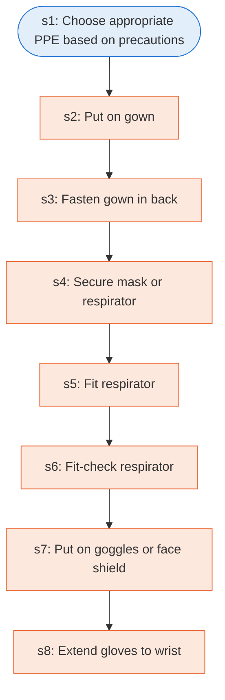

# Runbook: Sequence for putting on personal protective equipment (PPE)

Source: CDC, Sequence for Putting On PPE (CS250672-E), https://www.cdc.gov/hai/pdfs/ppe/ppe-sequence.pdf

Generated from the `LLM-compiled` workflow spec. Rounded boxes are agent steps, square boxes are human steps.

| Step | Action | Owner | Executor | Hands to | Deadline | Source lines |
|---|---|---|---|---|---|---|
| s1 | Choose appropriate PPE based on precautions | user | agent |  |  | L1 |
| s2 | Put on gown | user | human |  |  | L2 |
| s3 | Fasten gown in back | user | human |  |  | L3 |
| s4 | Secure mask or respirator | user | human |  |  | L4 |
| s5 | Fit respirator | user | human |  |  | L5 |
| s6 | Fit-check respirator | user | human |  |  | L6 |
| s7 | Put on goggles or face shield | user | human |  |  | L7 |
| s8 | Extend gloves to wrist | user | human |  |  | L8 |

## Handoffs

- none
