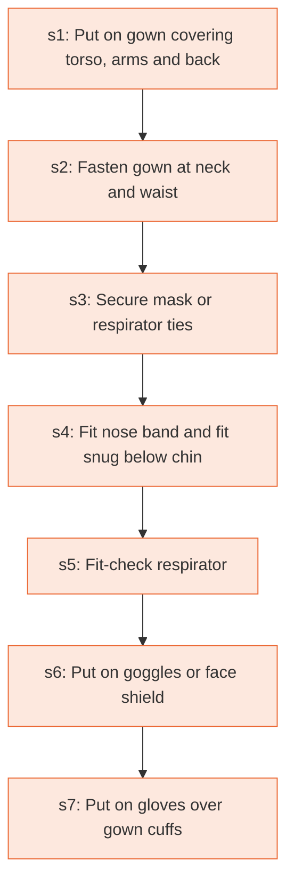

# Runbook: Sequence for putting on personal protective equipment (PPE)

Source: CDC, Sequence for Putting On PPE (CS250672-E), https://www.cdc.gov/hai/pdfs/ppe/ppe-sequence.pdf

Generated from the `gold` workflow spec. Rounded boxes are agent steps, square boxes are human steps.

| Step | Action | Owner | Executor | Hands to | Deadline | Source lines |
|---|---|---|---|---|---|---|
| s1 | Put on gown covering torso, arms and back | healthcare worker | human |  |  | L2 |
| s2 | Fasten gown at neck and waist | healthcare worker | human |  |  | L3 |
| s3 | Secure mask or respirator ties | healthcare worker | human |  |  | L4 |
| s4 | Fit nose band and fit snug below chin | healthcare worker | human |  |  | L5 |
| s5 | Fit-check respirator | healthcare worker | human |  |  | L6 |
| s6 | Put on goggles or face shield | healthcare worker | human |  |  | L7 |
| s7 | Put on gloves over gown cuffs | healthcare worker | human |  |  | L8 |

## Handoffs

- none
