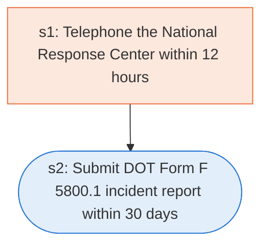

# Runbook: Hazardous materials incident notification and reporting

Source: 49 CFR 171.15 and 171.16 (PHMSA), https://www.ecfr.gov/current/title-49/subtitle-B/chapter-I/subchapter-C/part-171/subpart-B/section-171.15

Generated from the `gold` workflow spec. Rounded boxes are agent steps, square boxes are human steps.

| Step | Action | Owner | Executor | Hands to | Deadline | Source lines |
|---|---|---|---|---|---|---|
| s1 | Telephone the National Response Center within 12 hours | person in possession of the hazmat | human | National Response Center | no later than 12 hours after the occurrence of any such incident | L2 |
| s2 | Submit DOT Form F 5800.1 incident report within 30 days | person in possession of the hazmat | agent | PHMSA | within 30 days of discovery of the incident | L3 |

## Handoffs

- **s1** person in possession of the hazmat to **National Response Center**: Telephone the National Response Center within 12 hours
- **s2** person in possession of the hazmat to **PHMSA**: Submit DOT Form F 5800.1 incident report within 30 days
