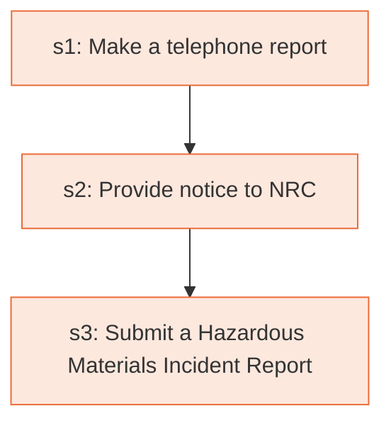

# Runbook: Hazardous materials incident notification and reporting

Source: 49 CFR 171.15 and 171.16 (PHMSA), https://www.ecfr.gov/current/title-49/subtitle-B/chapter-I/subchapter-C/part-171/subpart-B/section-171.15

Generated from the `LLM-compiled` workflow spec. Rounded boxes are agent steps, square boxes are human steps.

| Step | Action | Owner | Executor | Hands to | Deadline | Source lines |
|---|---|---|---|---|---|---|
| s1 | Make a telephone report | any person in physical possession of hazardous material | human | NRC |  | L1 |
| s2 | Provide notice to NRC | any person in physical possession of hazardous material | human |  | no later than 12 hours after the occurrence of any such incident | L2 |
| s3 | Submit a Hazardous Materials Incident Report | any person in physical possession of hazardous material | human |  | within 30 days of discovery of the incident | L3 |

## Handoffs

- **s1** any person in physical possession of hazardous material to **NRC**: Make a telephone report
