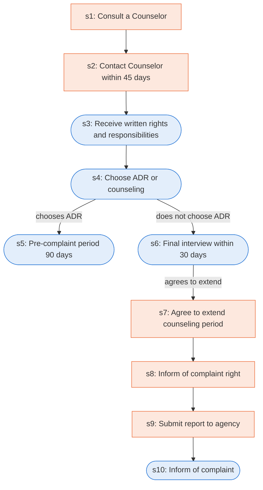

# Runbook: Federal sector EEO pre-complaint processing

Source: 29 CFR 1614.105 (EEOC), https://www.ecfr.gov/current/title-29/subtitle-B/chapter-XIV/part-1614/subpart-A/section-1614.105

Generated from the `LLM-compiled` workflow spec. Rounded boxes are agent steps, square boxes are human steps.

| Step | Action | Owner | Executor | Hands to | Deadline | Source lines |
|---|---|---|---|---|---|---|
| s1 | Consult a Counselor | aggrieved person | human |  |  | L1 |
| s2 | Contact Counselor within 45 days | aggrieved person | human |  | within 45 days of the date of the matter alleged to be discriminatory or; within 45 days of the effective date of the action | L2 |
| s3 | Receive written rights and responsibilities | aggrieved person | agent |  |  | L3 |
| s4 | Choose ADR or counseling | aggrieved person | agent | Counselor |  | L4 |
| s5 | Pre-complaint period 90 days | Counselor | agent |  |  | L5 |
| s6 | Final interview within 30 days | Counselor | agent | aggrieved person | within 30 days of the date the aggrieved person contacted the agency's EEO office to request counseling | L6 |
| s7 | Agree to extend counseling period | aggrieved person | human |  |  | L7 |
| s8 | Inform of complaint right | Counselor | human | aggrieved person | within 15 days of receipt of the notice and of the appropriate official with whom to file a complaint | L8 |
| s9 | Submit report to agency | Counselor | human | agency office | within 15 days to the agency office that has been designated to accept complaints and the aggrieved person concerning the issues discussed and actions taken during counseling | L9 |
| s10 | Inform of complaint | Counselor | agent | aggrieved person |  | L10 |

## Handoffs

- **s4** aggrieved person to **Counselor**: Choose ADR or counseling
- **s6** Counselor to **aggrieved person**: Final interview within 30 days
- **s8** Counselor to **aggrieved person**: Inform of complaint right
- **s9** Counselor to **agency office**: Submit report to agency
- **s10** Counselor to **aggrieved person**: Inform of complaint
