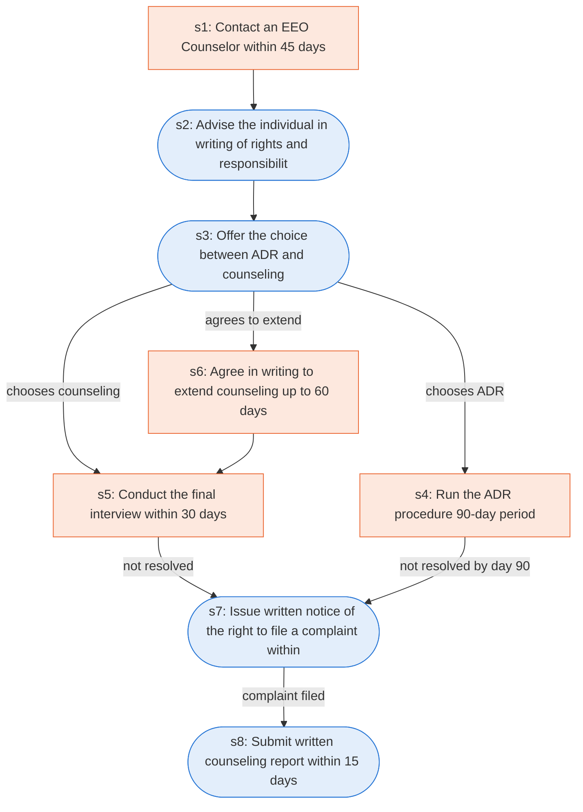

# Runbook: Federal sector EEO pre-complaint processing

Source: 29 CFR 1614.105 (EEOC), https://www.ecfr.gov/current/title-29/subtitle-B/chapter-XIV/part-1614/subpart-A/section-1614.105

Generated from the `gold` workflow spec. Rounded boxes are agent steps, square boxes are human steps.

| Step | Action | Owner | Executor | Hands to | Deadline | Source lines |
|---|---|---|---|---|---|---|
| s1 | Contact an EEO Counselor within 45 days | aggrieved person | human | EEO Counselor | within 45 days of the date of the matter alleged to be discriminatory or; within 45 days of the effective date of the action | L1, L2 |
| s2 | Advise the individual in writing of rights and responsibilities | EEO Counselor | agent | aggrieved person |  | L3 |
| s3 | Offer the choice between ADR and counseling | EEO Counselor | agent | aggrieved person |  | L4 |
| s4 | Run the ADR procedure (90-day period) | agency | human |  |  | L5 |
| s5 | Conduct the final interview within 30 days | EEO Counselor | human |  | within 30 days of the date the aggrieved person contacted the agency's EEO office to request counseling | L6 |
| s6 | Agree in writing to extend counseling up to 60 days | aggrieved person | human |  |  | L7 |
| s7 | Issue written notice of the right to file a complaint within 15 days | EEO Counselor | agent | aggrieved person | within 15 days of receipt of the notice and of the appropriate official with whom to file a complaint | L8 |
| s8 | Submit written counseling report within 15 days | EEO Counselor | agent | agency complaints office | within 15 days to the agency office that has been designated to accept complaints and the aggrieved person concerning the issues discussed and actions taken during counseling | L9 |

## Handoffs

- **s1** aggrieved person to **EEO Counselor**: Contact an EEO Counselor within 45 days
- **s2** EEO Counselor to **aggrieved person**: Advise the individual in writing of rights and responsibilities
- **s3** EEO Counselor to **aggrieved person**: Offer the choice between ADR and counseling
- **s7** EEO Counselor to **aggrieved person**: Issue written notice of the right to file a complaint within 15 days
- **s8** EEO Counselor to **agency complaints office**: Submit written counseling report within 15 days
