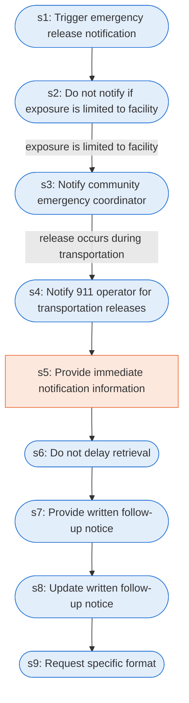

# Runbook: Emergency release notification

Source: 40 CFR 355.40 to 355.43 (EPA), https://www.ecfr.gov/current/title-40/chapter-I/subchapter-J/part-355/subpart-C

Generated from the `LLM-compiled` workflow spec. Rounded boxes are agent steps, square boxes are human steps.

| Step | Action | Owner | Executor | Hands to | Deadline | Source lines |
|---|---|---|---|---|---|---|
| s1 | Trigger emergency release notification | facility | agent |  | within any 24-hour period triggers the emergency release notification requirements | L1 |
| s2 | Do not notify if exposure is limited to facility | facility | agent |  | within the boundaries of your facility | L2 |
| s3 | Notify community emergency coordinator | facility | agent | community emergency coordinator |  | L3 |
| s4 | Notify 911 operator for transportation releases | facility | agent | 911 operator |  | L4 |
| s5 | Provide immediate notification information | facility | human |  |  | L5 |
| s6 | Do not delay retrieval | facility | agent |  |  | L6 |
| s7 | Provide written follow-up notice | facility | agent | SERC and LEPC |  | L7 |
| s8 | Update written follow-up notice | facility | agent |  |  | L8 |
| s9 | Request specific format | facility | agent | SERC and LEPC |  | L9 |

## Handoffs

- **s3** facility to **community emergency coordinator**: Notify community emergency coordinator
- **s4** facility to **911 operator**: Notify 911 operator for transportation releases
- **s7** facility to **SERC and LEPC**: Provide written follow-up notice
- **s9** facility to **SERC and LEPC**: Request specific format
