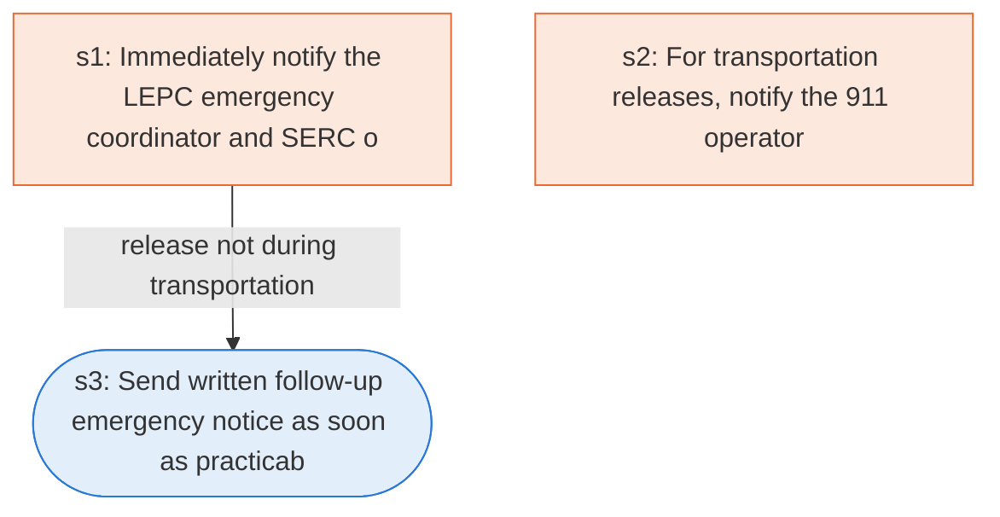

# Runbook: Emergency release notification

Source: 40 CFR 355.40 to 355.43 (EPA), https://www.ecfr.gov/current/title-40/chapter-I/subchapter-J/part-355/subpart-C

Generated from the `gold` workflow spec. Rounded boxes are agent steps, square boxes are human steps.

| Step | Action | Owner | Executor | Hands to | Deadline | Source lines |
|---|---|---|---|---|---|---|
| s1 | Immediately notify the LEPC emergency coordinator and SERC orally with release details | facility | human | LEPC and SERC |  | L3, L5 |
| s2 | For transportation releases, notify the 911 operator | facility | human | 911 operator |  | L4 |
| s3 | Send written follow-up emergency notice as soon as practicable | facility | agent | LEPC and SERC |  | L7, L8 |

## Handoffs

- **s1** facility to **LEPC and SERC**: Immediately notify the LEPC emergency coordinator and SERC orally with release details
- **s2** facility to **911 operator**: For transportation releases, notify the 911 operator
- **s3** facility to **LEPC and SERC**: Send written follow-up emergency notice as soon as practicable
