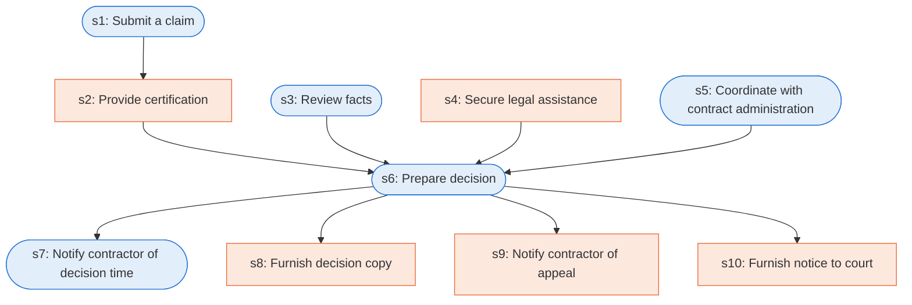

# Runbook: Contract disputes: claims and the contracting officer's decision

Source: FAR 33.206, 33.207, 33.211 (48 CFR), https://www.acquisition.gov/far/33.211

Generated from the `LLM-compiled` workflow spec. Rounded boxes are agent steps, square boxes are human steps.

| Step | Action | Owner | Executor | Hands to | Deadline | Source lines |
|---|---|---|---|---|---|---|
| s1 | Submit a claim | contractor | agent | contracting officer | within 6 years after accrual of a claim | L1 |
| s2 | Provide certification | contractor | human |  |  | L2 |
| s3 | Review facts | contracting officer | agent |  |  | L3 |
| s4 | Secure legal assistance | contracting officer | human |  |  | L4 |
| s5 | Coordinate with contract administration | contracting officer | agent |  |  | L5 |
| s6 | Prepare decision | contracting officer | agent | contractor |  | L6 |
| s7 | Notify contractor of decision time | contracting officer | agent | contractor | within 60 days; within that period; within which a decision will be issued | L7 |
| s8 | Furnish decision copy | contracting officer | human | contractor |  | L8 |
| s9 | Notify contractor of appeal | contracting officer | human | contractor | within 90 days from the date you receive this decision | L9 |
| s10 | Furnish notice to court | contracting officer | human |  | within 12 months of the date you receive this decision | L10 |

## Handoffs

- **s1** contractor to **contracting officer**: Submit a claim
- **s6** contracting officer to **contractor**: Prepare decision
- **s7** contracting officer to **contractor**: Notify contractor of decision time
- **s8** contracting officer to **contractor**: Furnish decision copy
- **s9** contracting officer to **contractor**: Notify contractor of appeal
