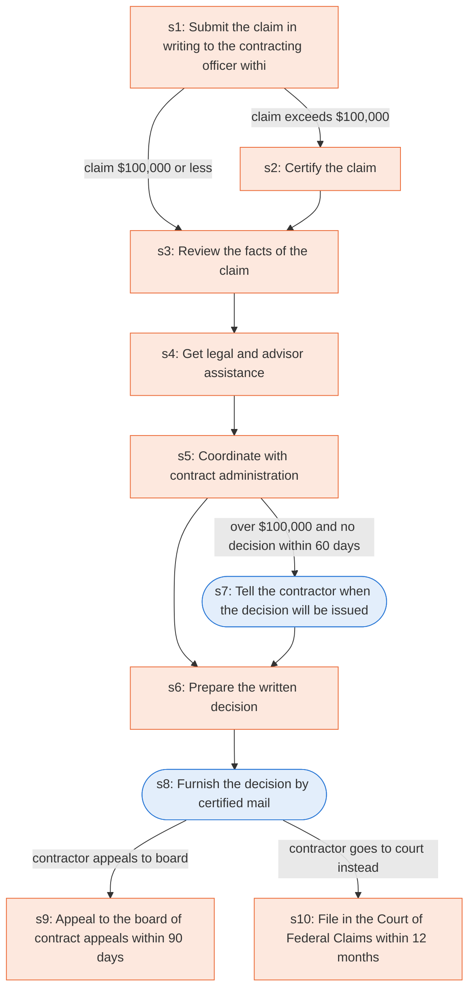

# Runbook: Contract disputes: claims and the contracting officer's decision

Source: FAR 33.206, 33.207, 33.211 (48 CFR), https://www.acquisition.gov/far/33.211

Generated from the `gold` workflow spec. Rounded boxes are agent steps, square boxes are human steps.

| Step | Action | Owner | Executor | Hands to | Deadline | Source lines |
|---|---|---|---|---|---|---|
| s1 | Submit the claim in writing to the contracting officer within 6 years | contractor | human | contracting officer | within 6 years after accrual of a claim | L1 |
| s2 | Certify the claim | contractor | human |  |  | L2 |
| s3 | Review the facts of the claim | contracting officer | human |  |  | L3 |
| s4 | Get legal and advisor assistance | contracting officer | human |  |  | L4 |
| s5 | Coordinate with contract administration | contracting officer | human |  |  | L5 |
| s6 | Prepare the written decision | contracting officer | human |  |  | L6 |
| s7 | Tell the contractor when the decision will be issued | contracting officer | agent | contractor | within 60 days; within that period; within which a decision will be issued | L7 |
| s8 | Furnish the decision by certified mail | contracting officer | agent | contractor |  | L8 |
| s9 | Appeal to the board of contract appeals within 90 days | contractor | human | board of contract appeals | within 90 days from the date you receive this decision | L9 |
| s10 | File in the Court of Federal Claims within 12 months | contractor | human | Court of Federal Claims | within 12 months of the date you receive this decision | L10 |

## Handoffs

- **s1** contractor to **contracting officer**: Submit the claim in writing to the contracting officer within 6 years
- **s7** contracting officer to **contractor**: Tell the contractor when the decision will be issued
- **s8** contracting officer to **contractor**: Furnish the decision by certified mail
- **s9** contractor to **board of contract appeals**: Appeal to the board of contract appeals within 90 days
- **s10** contractor to **Court of Federal Claims**: File in the Court of Federal Claims within 12 months
