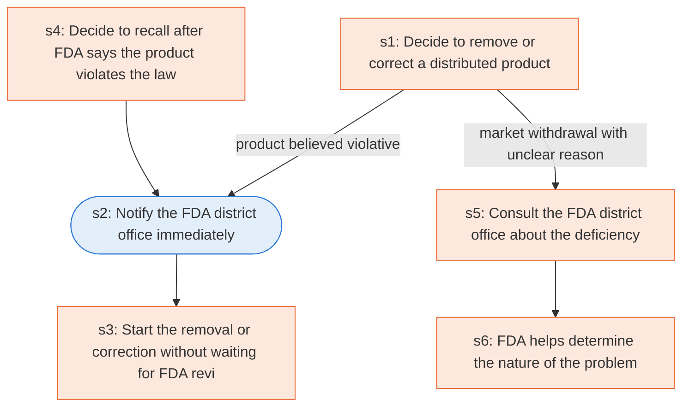

# Runbook: Firm-initiated recall

Source: 21 CFR 7.46 (FDA), https://www.ecfr.gov/current/title-21/chapter-I/subchapter-A/part-7/subpart-C/section-7.46

Generated from the `gold` workflow spec. Rounded boxes are agent steps, square boxes are human steps.

| Step | Action | Owner | Executor | Hands to | Deadline | Source lines |
|---|---|---|---|---|---|---|
| s1 | Decide to remove or correct a distributed product | firm | human |  |  | L1 |
| s2 | Notify the FDA district office immediately | firm | agent | FDA district office |  | L2 |
| s3 | Start the removal or correction without waiting for FDA review | firm | human |  |  | L3 |
| s4 | Decide to recall after FDA says the product violates the law | firm | human |  |  | L4 |
| s5 | Consult the FDA district office about the deficiency | firm | human | FDA district office |  | L5 |
| s6 | FDA helps determine the nature of the problem | FDA | human |  |  | L6 |

## Handoffs

- **s2** firm to **FDA district office**: Notify the FDA district office immediately
- **s5** firm to **FDA district office**: Consult the FDA district office about the deficiency
