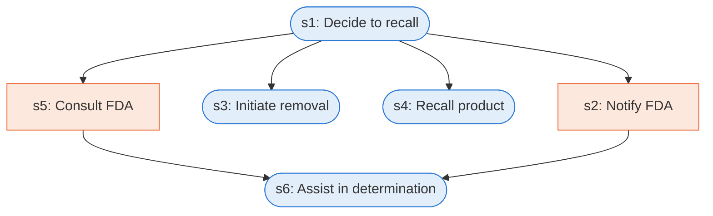

# Runbook: Firm-initiated recall

Source: 21 CFR 7.46 (FDA), https://www.ecfr.gov/current/title-21/chapter-I/subchapter-A/part-7/subpart-C/section-7.46

Generated from the `LLM-compiled` workflow spec. Rounded boxes are agent steps, square boxes are human steps.

| Step | Action | Owner | Executor | Hands to | Deadline | Source lines |
|---|---|---|---|---|---|---|
| s1 | Decide to recall | firm | agent |  |  | L1 |
| s2 | Notify FDA | firm | human | FDA |  | L2 |
| s3 | Initiate removal | firm | agent |  |  | L3 |
| s4 | Recall product | firm | agent |  |  | L4 |
| s5 | Consult FDA | firm | human | FDA |  | L5 |
| s6 | Assist in determination | FDA | agent | firm |  | L6 |

## Handoffs

- **s2** firm to **FDA**: Notify FDA
- **s5** firm to **FDA**: Consult FDA
- **s6** FDA to **firm**: Assist in determination
