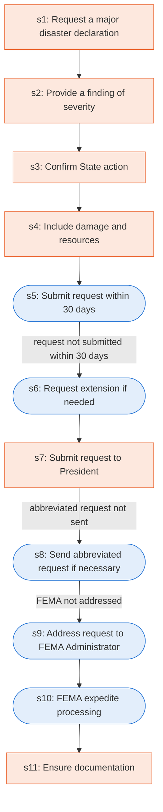

# Runbook: Requests for major disaster declarations

Source: 44 CFR 206.36 (FEMA), https://www.ecfr.gov/current/title-44/chapter-I/subchapter-D/part-206/subpart-B/section-206.36

Generated from the `LLM-compiled` workflow spec. Rounded boxes are agent steps, square boxes are human steps.

| Step | Action | Owner | Executor | Hands to | Deadline | Source lines |
|---|---|---|---|---|---|---|
| s1 | Request a major disaster declaration | Governor of a State | human |  |  | L1 |
| s2 | Provide a finding of severity | Governor of a State | human |  |  | L2 |
| s3 | Confirm State action | Governor of a State | human | State |  | L3 |
| s4 | Include damage and resources | Governor of a State | human |  |  | L4 |
| s5 | Submit request within 30 days | Governor of a State | agent |  | within 30 days of the occurrence of the incident in order to be considered | L5 |
| s6 | Request extension if needed | Governor of a State | agent | Assistant Administrator |  | L6 |
| s7 | Submit request to President | Governor of a State | human | President |  | L7 |
| s8 | Send abbreviated request if necessary | Governor of a State | agent | Regional Administrator |  | L8 |
| s9 | Address request to FEMA Administrator | Governor of a State | agent | FEMA Administrator |  | L9 |
| s10 | FEMA expedite processing | FEMA | agent | President |  | L10 |
| s11 | Ensure documentation | Assistant Administrator for Disaster Assistance Directorate | human |  |  | L11 |

## Handoffs

- **s3** Governor of a State to **State**: Confirm State action
- **s6** Governor of a State to **Assistant Administrator**: Request extension if needed
- **s7** Governor of a State to **President**: Submit request to President
- **s8** Governor of a State to **Regional Administrator**: Send abbreviated request if necessary
- **s9** Governor of a State to **FEMA Administrator**: Address request to FEMA Administrator
- **s10** FEMA to **President**: FEMA expedite processing
