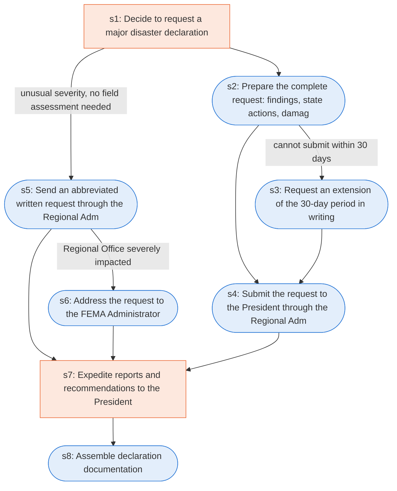

# Runbook: Requests for major disaster declarations

Source: 44 CFR 206.36 (FEMA), https://www.ecfr.gov/current/title-44/chapter-I/subchapter-D/part-206/subpart-B/section-206.36

Generated from the `gold` workflow spec. Rounded boxes are agent steps, square boxes are human steps.

| Step | Action | Owner | Executor | Hands to | Deadline | Source lines |
|---|---|---|---|---|---|---|
| s1 | Decide to request a major disaster declaration | Governor | human |  |  | L1 |
| s2 | Prepare the complete request: findings, state actions, damage estimates, certification | Governor | agent |  |  | L2, L3, L4 |
| s3 | Request an extension of the 30-day period in writing | Governor | agent | Assistant Administrator, Disaster Assistance |  | L6 |
| s4 | Submit the request to the President through the Regional Administrator within 30 days | Governor | agent | Regional Administrator | within 30 days of the occurrence of the incident in order to be considered | L5, L7 |
| s5 | Send an abbreviated written request through the Regional Administrator | Governor | agent | Regional Administrator |  | L8 |
| s6 | Address the request to the FEMA Administrator | Governor | agent | FEMA Administrator |  | L9 |
| s7 | Expedite reports and recommendations to the President | FEMA | human | President |  | L10 |
| s8 | Assemble declaration documentation | Assistant Administrator, Disaster Assistance | agent |  |  | L11 |

## Handoffs

- **s3** Governor to **Assistant Administrator, Disaster Assistance**: Request an extension of the 30-day period in writing
- **s4** Governor to **Regional Administrator**: Submit the request to the President through the Regional Administrator within 30 days
- **s5** Governor to **Regional Administrator**: Send an abbreviated written request through the Regional Administrator
- **s6** Governor to **FEMA Administrator**: Address the request to the FEMA Administrator
- **s7** FEMA to **President**: Expedite reports and recommendations to the President
