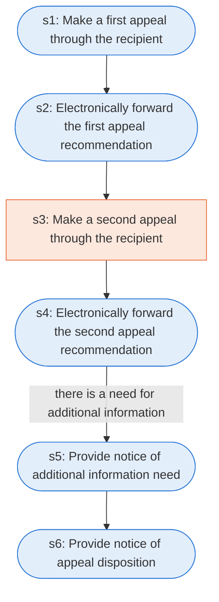

# Runbook: Public Assistance appeals

Source: 44 CFR 206.206 (FEMA), https://www.ecfr.gov/current/title-44/chapter-I/subchapter-D/part-206/subpart-G/section-206.206

Generated from the `LLM-compiled` workflow spec. Rounded boxes are agent steps, square boxes are human steps.

| Step | Action | Owner | Executor | Hands to | Deadline | Source lines |
|---|---|---|---|---|---|---|
| s1 | Make a first appeal through the recipient | applicant | agent | recipient | within 60 calendar days from the date of the FEMA determination that is the subject of the appeal | L2 |
| s2 | Electronically forward the first appeal recommendation | recipient | agent | Regional Administrator | within 120 calendar days from the date of the FEMA determination | L3 |
| s3 | Make a second appeal through the recipient | applicant | human | recipient | within 60 calendar days from the date of the Regional Administrator's first appeal decision | L4 |
| s4 | Electronically forward the second appeal recommendation | recipient | agent | Assistant Administrator for the Recovery Directorate | within 120 calendar days from the date of the Regional Administrator's first appeal decision | L5 |
| s5 | Provide notice of additional information need | Assistant Administrator for the Recovery Directorate | agent | recipient and applicant | Within 90 calendar days following receipt of a second appeal | L6 |
| s6 | Provide notice of appeal disposition | Assistant Administrator for the Recovery Directorate | agent | recipient and applicant | within 90 calendar days of receipt of the appeal or following the receipt of additional information | L7 |

## Handoffs

- **s1** applicant to **recipient**: Make a first appeal through the recipient
- **s2** recipient to **Regional Administrator**: Electronically forward the first appeal recommendation
- **s3** applicant to **recipient**: Make a second appeal through the recipient
- **s4** recipient to **Assistant Administrator for the Recovery Directorate**: Electronically forward the second appeal recommendation
- **s5** Assistant Administrator for the Recovery Directorate to **recipient and applicant**: Provide notice of additional information need
- **s6** Assistant Administrator for the Recovery Directorate to **recipient and applicant**: Provide notice of appeal disposition
