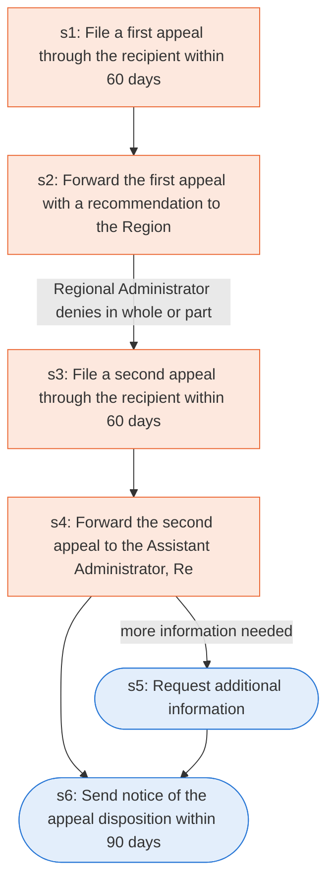

# Runbook: Public Assistance appeals

Source: 44 CFR 206.206 (FEMA), https://www.ecfr.gov/current/title-44/chapter-I/subchapter-D/part-206/subpart-G/section-206.206

Generated from the `gold` workflow spec. Rounded boxes are agent steps, square boxes are human steps.

| Step | Action | Owner | Executor | Hands to | Deadline | Source lines |
|---|---|---|---|---|---|---|
| s1 | File a first appeal through the recipient within 60 days | applicant | human | recipient | within 60 calendar days from the date of the FEMA determination that is the subject of the appeal | L2 |
| s2 | Forward the first appeal with a recommendation to the Regional Administrator | recipient | human | Regional Administrator | within 120 calendar days from the date of the FEMA determination | L3 |
| s3 | File a second appeal through the recipient within 60 days | applicant | human | recipient | within 60 calendar days from the date of the Regional Administrator's first appeal decision | L4 |
| s4 | Forward the second appeal to the Assistant Administrator, Recovery | recipient | human | Assistant Administrator, Recovery | within 120 calendar days from the date of the Regional Administrator's first appeal decision | L5 |
| s5 | Request additional information | Assistant Administrator, Recovery | agent | recipient and applicant | Within 90 calendar days following receipt of a second appeal | L6 |
| s6 | Send notice of the appeal disposition within 90 days | Assistant Administrator, Recovery | agent | recipient and applicant | within 90 calendar days of receipt of the appeal or following the receipt of additional information | L7 |

## Handoffs

- **s1** applicant to **recipient**: File a first appeal through the recipient within 60 days
- **s2** recipient to **Regional Administrator**: Forward the first appeal with a recommendation to the Regional Administrator
- **s3** applicant to **recipient**: File a second appeal through the recipient within 60 days
- **s4** recipient to **Assistant Administrator, Recovery**: Forward the second appeal to the Assistant Administrator, Recovery
- **s5** Assistant Administrator, Recovery to **recipient and applicant**: Request additional information
- **s6** Assistant Administrator, Recovery to **recipient and applicant**: Send notice of the appeal disposition within 90 days
