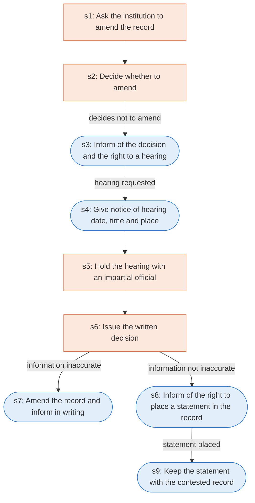

# Runbook: Procedures for amending education records

Source: 34 CFR 99.20 to 99.22 (Department of Education), https://www.ecfr.gov/current/title-34/subtitle-A/part-99/subpart-C

Generated from the `gold` workflow spec. Rounded boxes are agent steps, square boxes are human steps.

| Step | Action | Owner | Executor | Hands to | Deadline | Source lines |
|---|---|---|---|---|---|---|
| s1 | Ask the institution to amend the record | parent or eligible student | human | institution |  | L1 |
| s2 | Decide whether to amend | institution | human |  | within a reasonable time after the agency or institution receives the request | L2 |
| s3 | Inform of the decision and the right to a hearing | institution | agent | parent or eligible student |  | L3 |
| s4 | Give notice of hearing date, time and place | institution | agent | parent or eligible student |  | L4 |
| s5 | Hold the hearing with an impartial official | hearing officer | human |  |  | L5 |
| s6 | Issue the written decision | institution | human |  | within a reasonable period of time after the hearing | L6 |
| s7 | Amend the record and inform in writing | institution | agent | parent or eligible student |  | L7 |
| s8 | Inform of the right to place a statement in the record | institution | agent | parent or eligible student |  | L8 |
| s9 | Keep the statement with the contested record | institution | agent |  |  | L9 |

## Handoffs

- **s1** parent or eligible student to **institution**: Ask the institution to amend the record
- **s3** institution to **parent or eligible student**: Inform of the decision and the right to a hearing
- **s4** institution to **parent or eligible student**: Give notice of hearing date, time and place
- **s7** institution to **parent or eligible student**: Amend the record and inform in writing
- **s8** institution to **parent or eligible student**: Inform of the right to place a statement in the record
