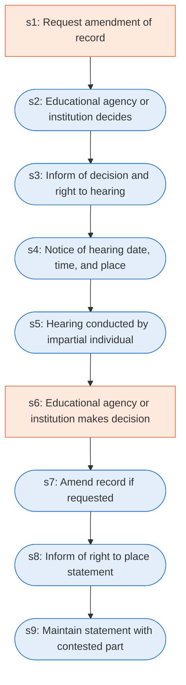

# Runbook: Procedures for amending education records

Source: 34 CFR 99.20 to 99.22 (Department of Education), https://www.ecfr.gov/current/title-34/subtitle-A/part-99/subpart-C

Generated from the `LLM-compiled` workflow spec. Rounded boxes are agent steps, square boxes are human steps.

| Step | Action | Owner | Executor | Hands to | Deadline | Source lines |
|---|---|---|---|---|---|---|
| s1 | Request amendment of record | parent or eligible student | human | educational agency or institution |  | L1 |
| s2 | Educational agency or institution decides | educational agency or institution | agent |  | within a reasonable time after the agency or institution receives the request | L2 |
| s3 | Inform of decision and right to hearing | educational agency or institution | agent | parent or eligible student |  | L3 |
| s4 | Notice of hearing date, time, and place | educational agency or institution | agent | parent or eligible student |  | L4 |
| s5 | Hearing conducted by impartial individual | any individual | agent |  |  | L5 |
| s6 | Educational agency or institution makes decision | educational agency or institution | human |  | within a reasonable period of time after the hearing | L6 |
| s7 | Amend record if requested | educational agency or institution | agent | parent or eligible student |  | L7 |
| s8 | Inform of right to place statement | educational agency or institution | agent | parent or eligible student |  | L8 |
| s9 | Maintain statement with contested part | educational agency or institution | agent |  |  | L9 |

## Handoffs

- **s1** parent or eligible student to **educational agency or institution**: Request amendment of record
- **s3** educational agency or institution to **parent or eligible student**: Inform of decision and right to hearing
- **s4** educational agency or institution to **parent or eligible student**: Notice of hearing date, time, and place
- **s7** educational agency or institution to **parent or eligible student**: Amend record if requested
- **s8** educational agency or institution to **parent or eligible student**: Inform of right to place statement
