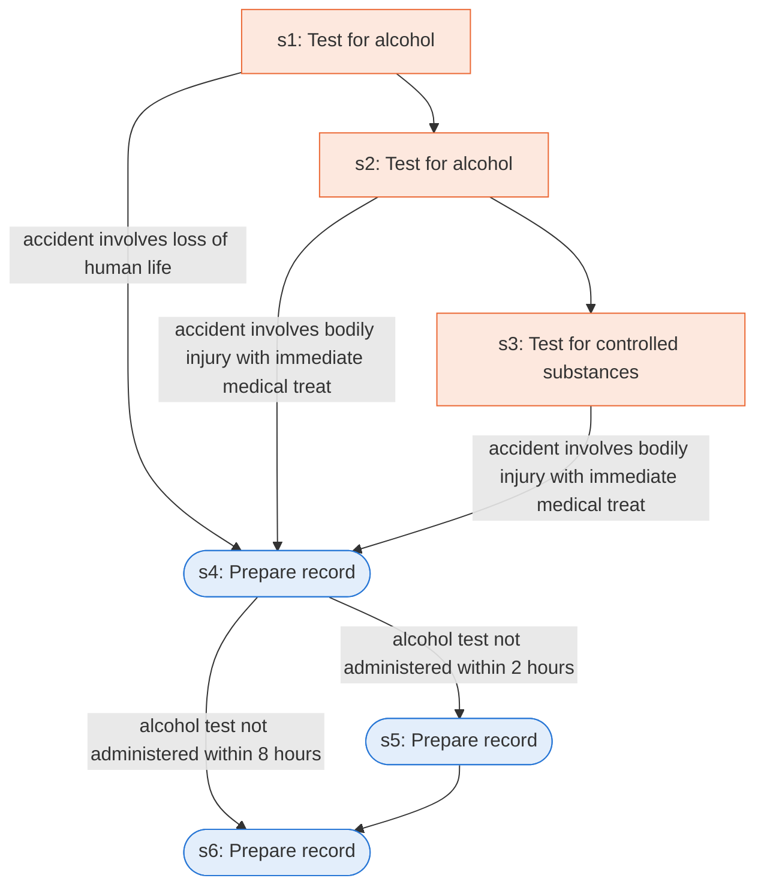

# Runbook: Commercial driver post-accident alcohol and drug testing

Source: 49 CFR 382.303 (FMCSA), https://www.ecfr.gov/current/title-49/subtitle-B/chapter-III/subchapter-B/part-382/subpart-C/section-382.303

Generated from the `LLM-compiled` workflow spec. Rounded boxes are agent steps, square boxes are human steps.

| Step | Action | Owner | Executor | Hands to | Deadline | Source lines |
|---|---|---|---|---|---|---|
| s1 | Test for alcohol | employer | human | driver |  | L1 |
| s2 | Test for alcohol | employer | human | driver | within 8 hours of the occurrence for a moving traffic violation arising from the accident | L2 |
| s3 | Test for controlled substances | employer | human | driver | within thirty-two hours of the occurrence for a moving traffic violation arising from the accident | L3 |
| s4 | Prepare record | employer | agent |  | within two hours following the accident | L4 |
| s5 | Prepare record | employer | agent |  | within eight hours following the accident | L5 |
| s6 | Prepare record | employer | agent |  | within 32 hours following the accident | L6 |

## Handoffs

- **s1** employer to **driver**: Test for alcohol
- **s2** employer to **driver**: Test for alcohol
- **s3** employer to **driver**: Test for controlled substances
