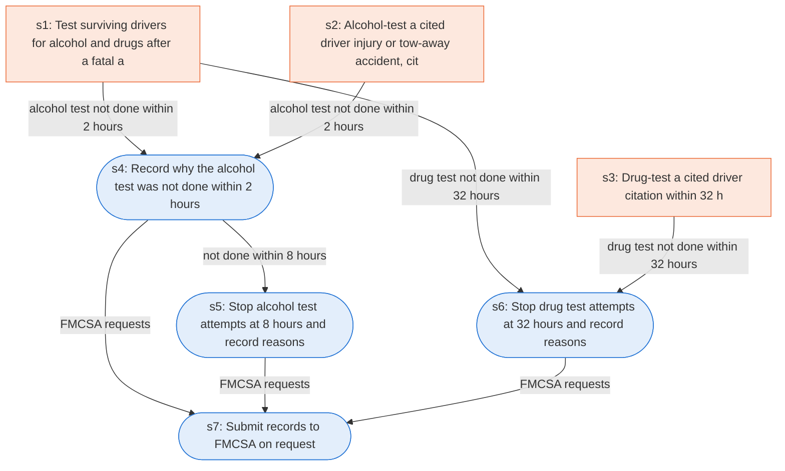

# Runbook: Commercial driver post-accident alcohol and drug testing

Source: 49 CFR 382.303 (FMCSA), https://www.ecfr.gov/current/title-49/subtitle-B/chapter-III/subchapter-B/part-382/subpart-C/section-382.303

Generated from the `gold` workflow spec. Rounded boxes are agent steps, square boxes are human steps.

| Step | Action | Owner | Executor | Hands to | Deadline | Source lines |
|---|---|---|---|---|---|---|
| s1 | Test surviving drivers for alcohol and drugs after a fatal accident | employer | human |  |  | L1 |
| s2 | Alcohol-test a cited driver (injury or tow-away accident, citation within 8 h) | employer | human |  | within 8 hours of the occurrence for a moving traffic violation arising from the accident | L2 |
| s3 | Drug-test a cited driver (citation within 32 h) | employer | human |  | within thirty-two hours of the occurrence for a moving traffic violation arising from the accident | L3 |
| s4 | Record why the alcohol test was not done within 2 hours | employer | agent |  | within two hours following the accident | L4 |
| s5 | Stop alcohol test attempts at 8 hours and record reasons | employer | agent |  | within eight hours following the accident | L5 |
| s6 | Stop drug test attempts at 32 hours and record reasons | employer | agent |  | within 32 hours following the accident | L6 |
| s7 | Submit records to FMCSA on request | employer | agent | FMCSA |  | L7 |

## Handoffs

- **s7** employer to **FMCSA**: Submit records to FMCSA on request
