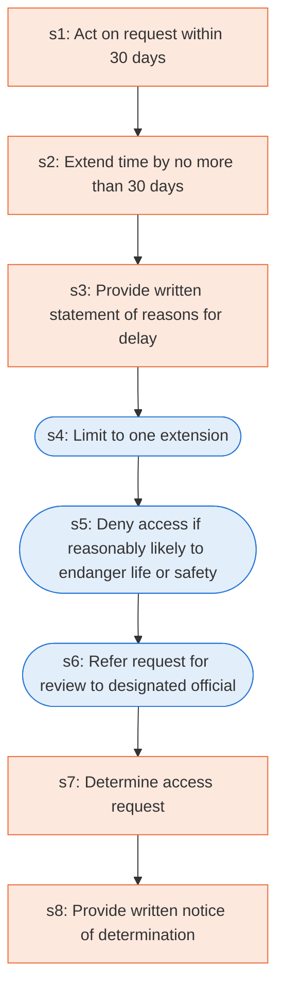

# Runbook: Individual requests for access to protected health information

Source: 45 CFR 164.524 (HHS), https://www.ecfr.gov/current/title-45/subtitle-A/subchapter-C/part-164/subpart-E/section-164.524

Generated from the `LLM-compiled` workflow spec. Rounded boxes are agent steps, square boxes are human steps.

| Step | Action | Owner | Executor | Hands to | Deadline | Source lines |
|---|---|---|---|---|---|---|
| s1 | Act on request within 30 days | covered entity | human |  | no later than 30 days after receipt of the request | L1 |
| s2 | Extend time by no more than 30 days | covered entity | human |  | within the time required | L2 |
| s3 | Provide written statement of reasons for delay | covered entity | human | individual | within the time limit | L3 |
| s4 | Limit to one extension | covered entity | agent |  |  | L4 |
| s5 | Deny access if reasonably likely to endanger life or safety | covered entity | agent | individual |  | L5 |
| s6 | Refer request for review to designated official | covered entity | agent | designated reviewing official |  | L6 |
| s7 | Determine access request | designated reviewing official | human | covered entity | within a reasonable period of time | L7 |
| s8 | Provide written notice of determination | covered entity | human | individual |  | L8 |

## Handoffs

- **s3** covered entity to **individual**: Provide written statement of reasons for delay
- **s5** covered entity to **individual**: Deny access if reasonably likely to endanger life or safety
- **s6** covered entity to **designated reviewing official**: Refer request for review to designated official
- **s7** designated reviewing official to **covered entity**: Determine access request
- **s8** covered entity to **individual**: Provide written notice of determination
