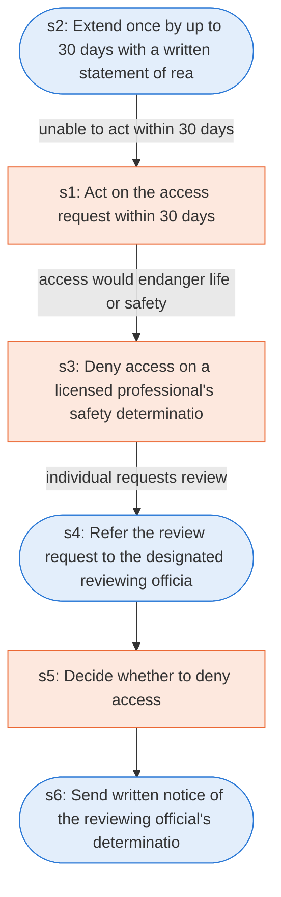

# Runbook: Individual requests for access to protected health information

Source: 45 CFR 164.524 (HHS), https://www.ecfr.gov/current/title-45/subtitle-A/subchapter-C/part-164/subpart-E/section-164.524

Generated from the `gold` workflow spec. Rounded boxes are agent steps, square boxes are human steps.

| Step | Action | Owner | Executor | Hands to | Deadline | Source lines |
|---|---|---|---|---|---|---|
| s1 | Act on the access request within 30 days | covered entity | human |  | no later than 30 days after receipt of the request | L1 |
| s2 | Extend once by up to 30 days with a written statement of reasons | covered entity | agent | individual | within the time required; within the time limit | L2, L3, L4 |
| s3 | Deny access on a licensed professional's safety determination | covered entity | human |  |  | L5 |
| s4 | Refer the review request to the designated reviewing official | covered entity | agent | reviewing official |  | L6 |
| s5 | Decide whether to deny access | reviewing official | human |  | within a reasonable period of time | L7 |
| s6 | Send written notice of the reviewing official's determination | covered entity | agent | individual |  | L8 |

## Handoffs

- **s2** covered entity to **individual**: Extend once by up to 30 days with a written statement of reasons
- **s4** covered entity to **reviewing official**: Refer the review request to the designated reviewing official
- **s6** covered entity to **individual**: Send written notice of the reviewing official's determination
