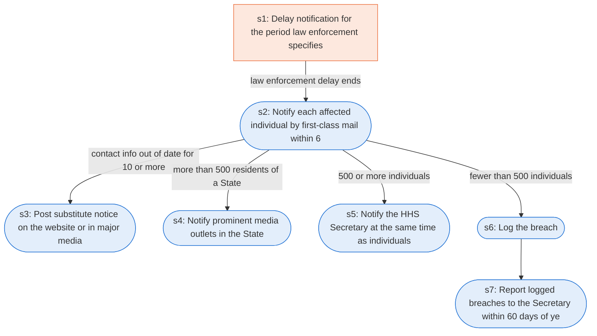

# Runbook: Notification in the case of breach of unsecured protected health information

Source: 45 CFR 164.404, 164.406, 164.408, 164.412 (HHS), https://www.ecfr.gov/current/title-45/subtitle-A/subchapter-C/part-164/subpart-D

Generated from the `gold` workflow spec. Rounded boxes are agent steps, square boxes are human steps.

| Step | Action | Owner | Executor | Hands to | Deadline | Source lines |
|---|---|---|---|---|---|---|
| s1 | Delay notification for the period law enforcement specifies | covered entity | human |  |  | L2 |
| s2 | Notify each affected individual by first-class mail within 60 days | covered entity | agent | affected individuals |  | L3, L4, L5 |
| s3 | Post substitute notice on the website or in major media | covered entity | agent | public |  | L6 |
| s4 | Notify prominent media outlets in the State | covered entity | agent | media |  | L7 |
| s5 | Notify the HHS Secretary at the same time as individuals | covered entity | agent | HHS Secretary |  | L8 |
| s6 | Log the breach | covered entity | agent |  |  | L9 |
| s7 | Report logged breaches to the Secretary within 60 days of year end | covered entity | agent | HHS Secretary | Not later than 60 days after the end of each calendar year | L10 |

## Handoffs

- **s2** covered entity to **affected individuals**: Notify each affected individual by first-class mail within 60 days
- **s3** covered entity to **public**: Post substitute notice on the website or in major media
- **s4** covered entity to **media**: Notify prominent media outlets in the State
- **s5** covered entity to **HHS Secretary**: Notify the HHS Secretary at the same time as individuals
- **s7** covered entity to **HHS Secretary**: Report logged breaches to the Secretary within 60 days of year end
