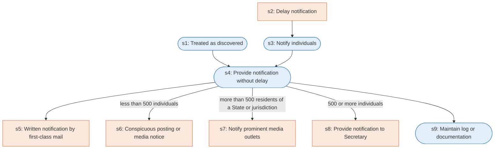

# Runbook: Notification in the case of breach of unsecured protected health information

Source: 45 CFR 164.404, 164.406, 164.408, 164.412 (HHS), https://www.ecfr.gov/current/title-45/subtitle-A/subchapter-C/part-164/subpart-D

Generated from the `LLM-compiled` workflow spec. Rounded boxes are agent steps, square boxes are human steps.

| Step | Action | Owner | Executor | Hands to | Deadline | Source lines |
|---|---|---|---|---|---|---|
| s1 | Treated as discovered | covered entity | agent |  |  | L1 |
| s2 | Delay notification | covered entity | human | law enforcement official |  | L2 |
| s3 | Notify individuals | covered entity | agent | individuals |  | L3 |
| s4 | Provide notification without delay | covered entity | agent |  |  | L4 |
| s5 | Written notification by first-class mail | covered entity | human | individuals |  | L5 |
| s6 | Conspicuous posting or media notice | covered entity | human |  |  | L6 |
| s7 | Notify prominent media outlets | covered entity | human | prominent media outlets |  | L7 |
| s8 | Provide notification to Secretary | covered entity | human | Secretary |  | L8 |
| s9 | Maintain log or documentation | covered entity | agent |  |  | L9 |

## Handoffs

- **s2** covered entity to **law enforcement official**: Delay notification
- **s3** covered entity to **individuals**: Notify individuals
- **s5** covered entity to **individuals**: Written notification by first-class mail
- **s7** covered entity to **prominent media outlets**: Notify prominent media outlets
- **s8** covered entity to **Secretary**: Provide notification to Secretary
