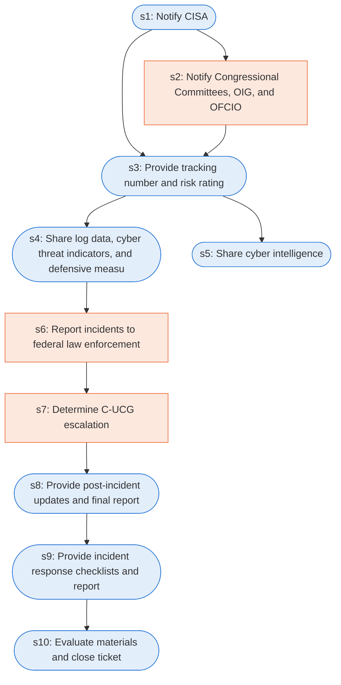

# Runbook: Federal incident coordination with CISA

Source: CISA Federal Government Cybersecurity Incident and Vulnerability Response Playbooks, https://www.cisa.gov/sites/default/files/2024-08/Federal_Government_Cybersecurity_Incident_and_Vulnerability_Response_Playbooks_508C.pdf

Generated from the `LLM-compiled` workflow spec. Rounded boxes are agent steps, square boxes are human steps.

| Step | Action | Owner | Executor | Hands to | Deadline | Source lines |
|---|---|---|---|---|---|---|
| s1 | Notify CISA | agency | agent | CISA | within 1 hour of incident determination as directed by OMB M-20-04 | L1 |
| s2 | Notify Congressional Committees, OIG, and OFCIO | agency | human |  |  | L2 |
| s3 | Provide tracking number and risk rating | CISA | agent | agency | Within one hour of receiving the initial report | L3 |
| s4 | Share log data, cyber threat indicators, and defensive measures | agency | agent | CISA and sharing partners |  | L4 |
| s5 | Share cyber intelligence | CISA | agent | intelligence community and law enforcement |  | L5 |
| s6 | Report incidents to federal law enforcement | agency | human |  |  | L6 |
| s7 | Determine C-UCG escalation | CISA or FBI | human |  |  | L7 |
| s8 | Provide post-incident updates and final report | agency | agent | CISA |  | L8 |
| s9 | Provide incident response checklists and report | agency | agent |  |  | L9 |
| s10 | Evaluate materials and close ticket | CISA | agent |  |  | L10 |

## Handoffs

- **s1** agency to **CISA**: Notify CISA
- **s3** CISA to **agency**: Provide tracking number and risk rating
- **s4** agency to **CISA and sharing partners**: Share log data, cyber threat indicators, and defensive measures
- **s5** CISA to **intelligence community and law enforcement**: Share cyber intelligence
- **s8** agency to **CISA**: Provide post-incident updates and final report
