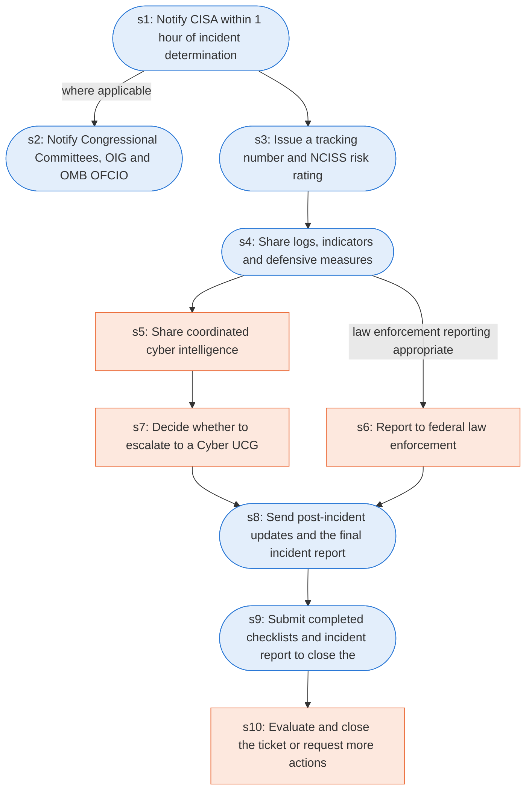

# Runbook: Federal incident coordination with CISA

Source: CISA Federal Government Cybersecurity Incident and Vulnerability Response Playbooks, https://www.cisa.gov/sites/default/files/2024-08/Federal_Government_Cybersecurity_Incident_and_Vulnerability_Response_Playbooks_508C.pdf

Generated from the `gold` workflow spec. Rounded boxes are agent steps, square boxes are human steps.

| Step | Action | Owner | Executor | Hands to | Deadline | Source lines |
|---|---|---|---|---|---|---|
| s1 | Notify CISA within 1 hour of incident determination | agency | agent | CISA | within 1 hour of incident determination as directed by OMB M-20-04 | L1 |
| s2 | Notify Congressional Committees, OIG and OMB OFCIO | agency | agent | Congress, OIG and OMB |  | L2 |
| s3 | Issue a tracking number and NCISS risk rating | CISA | agent | agency | Within one hour of receiving the initial report | L3 |
| s4 | Share logs, indicators and defensive measures | agency | agent | CISA and sharing partners |  | L4 |
| s5 | Share coordinated cyber intelligence | CISA | human | involved organizations |  | L5 |
| s6 | Report to federal law enforcement | agency | human | federal law enforcement |  | L6 |
| s7 | Decide whether to escalate to a Cyber UCG | CISA or FBI | human |  |  | L7 |
| s8 | Send post-incident updates and the final incident report | agency | agent | CISA |  | L8 |
| s9 | Submit completed checklists and incident report to close the ticket | agency | agent | CISA |  | L9 |
| s10 | Evaluate and close the ticket or request more actions | CISA | human | agency |  | L10 |

## Handoffs

- **s1** agency to **CISA**: Notify CISA within 1 hour of incident determination
- **s2** agency to **Congress, OIG and OMB**: Notify Congressional Committees, OIG and OMB OFCIO
- **s3** CISA to **agency**: Issue a tracking number and NCISS risk rating
- **s4** agency to **CISA and sharing partners**: Share logs, indicators and defensive measures
- **s5** CISA to **involved organizations**: Share coordinated cyber intelligence
- **s6** agency to **federal law enforcement**: Report to federal law enforcement
- **s8** agency to **CISA**: Send post-incident updates and the final incident report
- **s9** agency to **CISA**: Submit completed checklists and incident report to close the ticket
- **s10** CISA to **agency**: Evaluate and close the ticket or request more actions
