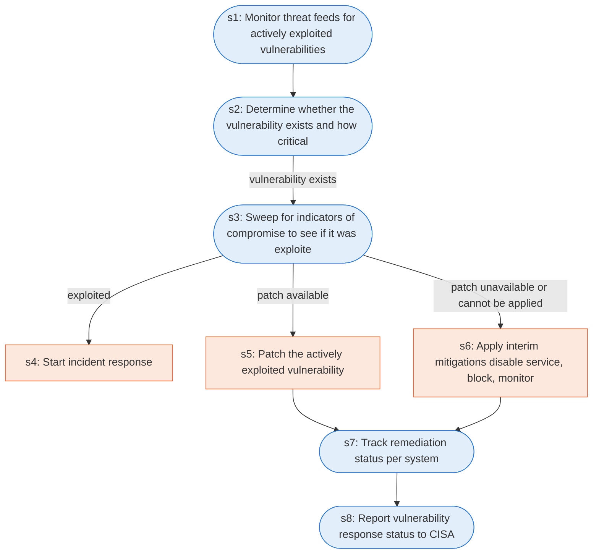

# Runbook: Vulnerability response for actively exploited vulnerabilities

Source: CISA Federal Government Cybersecurity Incident and Vulnerability Response Playbooks, https://www.cisa.gov/sites/default/files/2024-08/Federal_Government_Cybersecurity_Incident_and_Vulnerability_Response_Playbooks_508C.pdf

Generated from the `gold` workflow spec. Rounded boxes are agent steps, square boxes are human steps.

| Step | Action | Owner | Executor | Hands to | Deadline | Source lines |
|---|---|---|---|---|---|---|
| s1 | Monitor threat feeds for actively exploited vulnerabilities | agency | agent |  |  | L1 |
| s2 | Determine whether the vulnerability exists and how critical the asset is | agency | agent |  |  | L2, L3 |
| s3 | Sweep for indicators of compromise to see if it was exploited | agency | agent |  |  | L4 |
| s4 | Start incident response | agency | human | incident response team |  | L5 |
| s5 | Patch the actively exploited vulnerability | agency | human |  | within the environment in a timely manner | L6 |
| s6 | Apply interim mitigations (disable service, block, monitor) | agency | human |  |  | L7 |
| s7 | Track remediation status per system | agency | agent |  |  | L8 |
| s8 | Report vulnerability response status to CISA | agency | agent | CISA |  | L9 |

## Handoffs

- **s4** agency to **incident response team**: Start incident response
- **s8** agency to **CISA**: Report vulnerability response status to CISA
