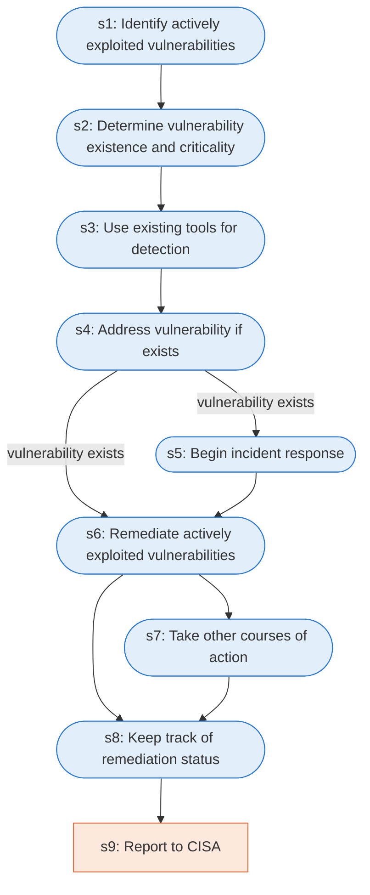

# Runbook: Vulnerability response for actively exploited vulnerabilities

Source: CISA Federal Government Cybersecurity Incident and Vulnerability Response Playbooks, https://www.cisa.gov/sites/default/files/2024-08/Federal_Government_Cybersecurity_Incident_and_Vulnerability_Response_Playbooks_508C.pdf

Generated from the `LLM-compiled` workflow spec. Rounded boxes are agent steps, square boxes are human steps.

| Step | Action | Owner | Executor | Hands to | Deadline | Source lines |
|---|---|---|---|---|---|---|
| s1 | Identify actively exploited vulnerabilities | security analyst | agent |  |  | L1 |
| s2 | Determine vulnerability existence and criticality | security analyst | agent |  |  | L2 |
| s3 | Use existing tools for detection | security analyst | agent |  |  | L3 |
| s4 | Address vulnerability if exists | security analyst | agent |  |  | L4 |
| s5 | Begin incident response | security analyst | agent | incident response team |  | L5 |
| s6 | Remediate actively exploited vulnerabilities | security analyst | agent |  | within the environment in a timely manner | L6 |
| s7 | Take other courses of action | security analyst | agent |  |  | L7 |
| s8 | Keep track of remediation status | security analyst | agent |  |  | L8 |
| s9 | Report to CISA | security analyst | human | CISA |  | L9 |

## Handoffs

- **s5** security analyst to **incident response team**: Begin incident response
- **s9** security analyst to **CISA**: Report to CISA
