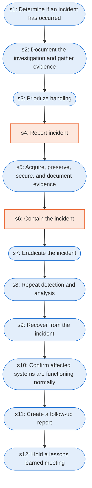

# Runbook: Incident handling checklist

Source: NIST SP 800-61 Rev. 2, Table 3-5, https://nvlpubs.nist.gov/nistpubs/SpecialPublications/NIST.SP.800-61r2.pdf

Generated from the `LLM-compiled` workflow spec. Rounded boxes are agent steps, square boxes are human steps.

| Step | Action | Owner | Executor | Hands to | Deadline | Source lines |
|---|---|---|---|---|---|---|
| s1 | Determine if an incident has occurred | handler | agent |  |  | L1 |
| s2 | Document the investigation and gather evidence | handler | agent |  |  | L2 |
| s3 | Prioritize handling | handler | agent |  |  | L3 |
| s4 | Report incident | handler | human | internal personnel and external organizations |  | L4 |
| s5 | Acquire, preserve, secure, and document evidence | handler | agent |  |  | L5 |
| s6 | Contain the incident | handler | human |  |  | L6 |
| s7 | Eradicate the incident | handler | agent |  |  | L7 |
| s8 | Repeat detection and analysis | handler | agent |  |  | L8 |
| s9 | Recover from the incident | handler | agent |  |  | L9 |
| s10 | Confirm affected systems are functioning normally | handler | agent |  |  | L10 |
| s11 | Create a follow-up report | handler | agent |  |  | L11 |
| s12 | Hold a lessons learned meeting | handler | agent |  |  | L12 |

## Handoffs

- **s4** handler to **internal personnel and external organizations**: Report incident
