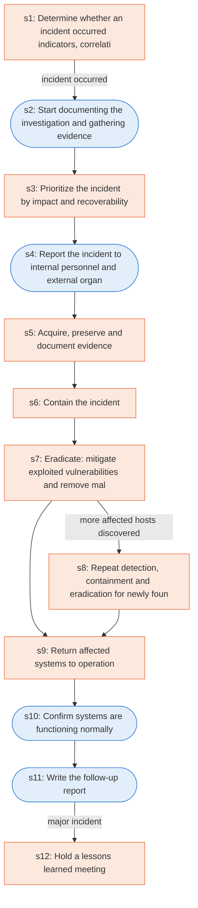

# Runbook: Incident handling checklist

Source: NIST SP 800-61 Rev. 2, Table 3-5, https://nvlpubs.nist.gov/nistpubs/SpecialPublications/NIST.SP.800-61r2.pdf

Generated from the `gold` workflow spec. Rounded boxes are agent steps, square boxes are human steps.

| Step | Action | Owner | Executor | Hands to | Deadline | Source lines |
|---|---|---|---|---|---|---|
| s1 | Determine whether an incident occurred (indicators, correlation, research) | incident handler | human |  |  | L1 |
| s2 | Start documenting the investigation and gathering evidence | incident handler | agent |  |  | L2 |
| s3 | Prioritize the incident by impact and recoverability | incident handler | human |  |  | L3 |
| s4 | Report the incident to internal personnel and external organizations | incident handler | agent | internal personnel and external organizations |  | L4 |
| s5 | Acquire, preserve and document evidence | incident handler | human |  |  | L5 |
| s6 | Contain the incident | incident handler | human |  |  | L6 |
| s7 | Eradicate: mitigate exploited vulnerabilities and remove malware | incident handler | human |  |  | L7 |
| s8 | Repeat detection, containment and eradication for newly found hosts | incident handler | human |  |  | L8 |
| s9 | Return affected systems to operation | incident handler | human |  |  | L9 |
| s10 | Confirm systems are functioning normally | incident handler | agent |  |  | L10 |
| s11 | Write the follow-up report | incident handler | agent |  |  | L11 |
| s12 | Hold a lessons learned meeting | incident response team | human |  |  | L12 |

## Handoffs

- **s4** incident handler to **internal personnel and external organizations**: Report the incident to internal personnel and external organizations
