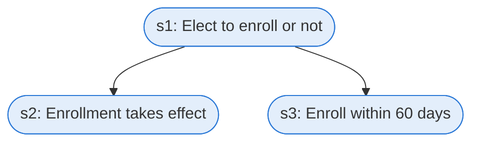

# Runbook: New employee health benefits enrollment (FEHB)

Source: 5 CFR 890.301, https://www.ecfr.gov/current/title-5/chapter-I/subchapter-B/part-890/subpart-C/section-890.301

Generated from the `LLM-compiled` workflow spec. Rounded boxes are agent steps, square boxes are human steps.

| Step | Action | Owner | Executor | Hands to | Deadline | Source lines |
|---|---|---|---|---|---|---|
| s1 | Elect to enroll or not | employee | agent |  | within 60 days after becoming eligible | L1 |
| s2 | Enrollment takes effect | employee | agent |  |  | L2 |
| s3 | Enroll within 60 days | employee | agent |  | within the time limits; within 60 days after the employing office advises the employee of its determination | L3 |

## Handoffs

- none
