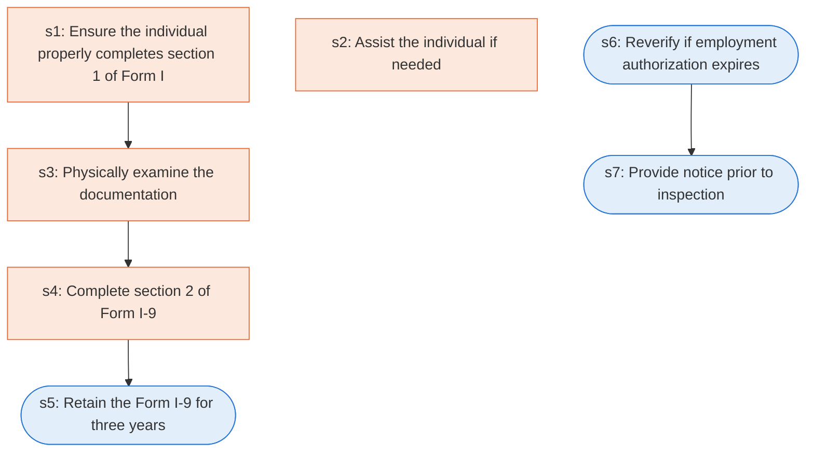

# Runbook: Employment eligibility verification (Form I-9)

Source: 8 CFR 274a.2(b) (DHS/USCIS), https://www.ecfr.gov/current/title-8/chapter-I/subchapter-B/part-274a/subpart-A/section-274a.2

Generated from the `LLM-compiled` workflow spec. Rounded boxes are agent steps, square boxes are human steps.

| Step | Action | Owner | Executor | Hands to | Deadline | Source lines |
|---|---|---|---|---|---|---|
| s1 | Ensure the individual properly completes section 1 of Form I-9 | employer | human |  |  | L1 |
| s2 | Assist the individual if needed | someone | human | employer |  | L2 |
| s3 | Physically examine the documentation | employer | human |  | Within three business days of the hire | L3 |
| s4 | Complete section 2 of Form I-9 | employer | human |  | Within three business days of the hire | L4 |
| s5 | Retain the Form I-9 for three years | employer | agent |  |  | L5 |
| s6 | Reverify if employment authorization expires | employer | agent |  | not later than the date work authorization expires | L6 |
| s7 | Provide notice prior to inspection | employer | agent |  |  | L7 |

## Handoffs

- **s2** someone to **employer**: Assist the individual if needed
