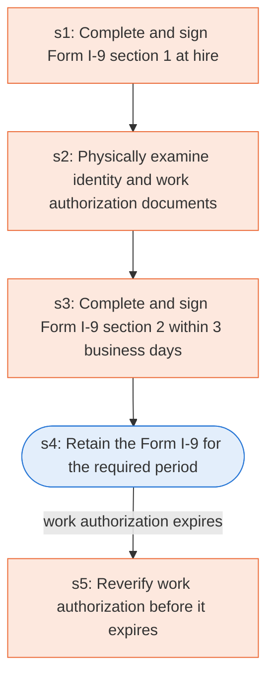

# Runbook: Employment eligibility verification (Form I-9)

Source: 8 CFR 274a.2(b) (DHS/USCIS), https://www.ecfr.gov/current/title-8/chapter-I/subchapter-B/part-274a/subpart-A/section-274a.2

Generated from the `gold` workflow spec. Rounded boxes are agent steps, square boxes are human steps.

| Step | Action | Owner | Executor | Hands to | Deadline | Source lines |
|---|---|---|---|---|---|---|
| s1 | Complete and sign Form I-9 section 1 at hire | employee | human |  |  | L1 |
| s2 | Physically examine identity and work authorization documents within 3 business days | employer | human |  | Within three business days of the hire | L3 |
| s3 | Complete and sign Form I-9 section 2 within 3 business days | employer | human |  | Within three business days of the hire | L4 |
| s4 | Retain the Form I-9 for the required period | employer | agent |  |  | L5 |
| s5 | Reverify work authorization before it expires | employer | human |  | not later than the date work authorization expires | L6 |

## Handoffs

- none
