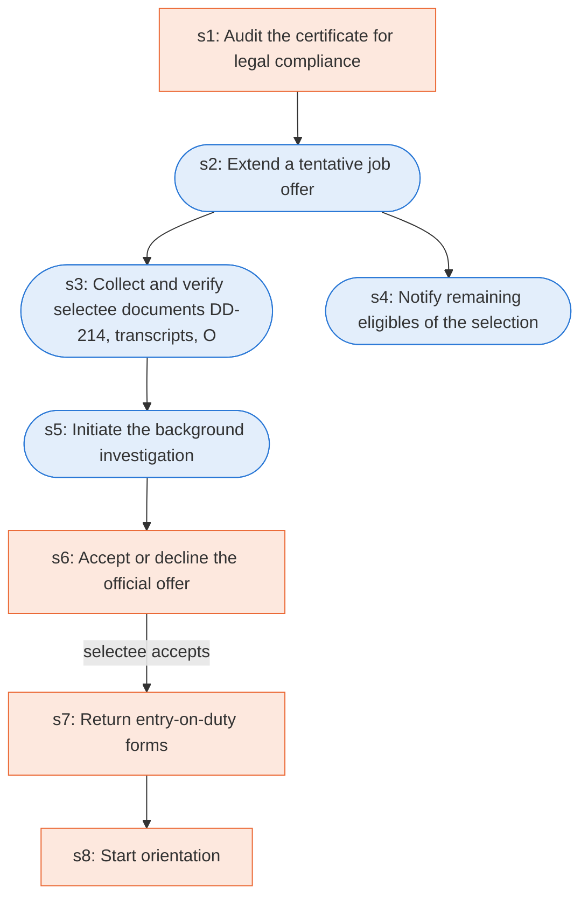

# Runbook: Federal hiring: tentative offer through entry on duty

Source: OPM End-to-End Hiring Roadmap (Hiring Elements), https://www.opm.gov/policy-data-oversight/human-capital-management/hiring-reform/hiringelements.pdf ; 5 CFR 731.106, https://www.ecfr.gov/current/title-5/chapter-I/subchapter-B/part-731/subpart-A/section-731.106

Generated from the `gold` workflow spec. Rounded boxes are agent steps, square boxes are human steps.

| Step | Action | Owner | Executor | Hands to | Deadline | Source lines |
|---|---|---|---|---|---|---|
| s1 | Audit the certificate for legal compliance | Human Resources Office | human |  |  | L2 |
| s2 | Extend a tentative job offer | Human Resources Office | agent | selectee |  | L3 |
| s3 | Collect and verify selectee documents (DD-214, transcripts, OF-306) | Human Resources Office | agent | selectee |  | L4 |
| s4 | Notify remaining eligibles of the selection | Human Resources Office | agent | remaining eligibles |  | L5 |
| s5 | Initiate the background investigation | Security Office | agent |  |  | L6 |
| s6 | Accept or decline the official offer | selectee | human |  |  | L7 |
| s7 | Return entry-on-duty forms | selectee | human | Human Resources Office |  | L8 |
| s8 | Start orientation | Human Resources Office | human |  |  | L9 |

## Handoffs

- **s2** Human Resources Office to **selectee**: Extend a tentative job offer
- **s3** Human Resources Office to **selectee**: Collect and verify selectee documents (DD-214, transcripts, OF-306)
- **s4** Human Resources Office to **remaining eligibles**: Notify remaining eligibles of the selection
- **s7** selectee to **Human Resources Office**: Return entry-on-duty forms
