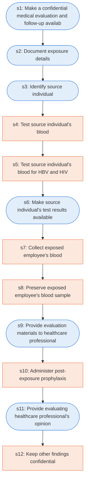

# Runbook: Bloodborne pathogens: post-exposure evaluation and follow-up

Source: 29 CFR 1910.1030(f)(3) to (f)(5) (OSHA), https://www.osha.gov/laws-regs/regulations/standardnumber/1910/1910.1030

Generated from the `LLM-compiled` workflow spec. Rounded boxes are agent steps, square boxes are human steps.

| Step | Action | Owner | Executor | Hands to | Deadline | Source lines |
|---|---|---|---|---|---|---|
| s1 | Make a confidential medical evaluation and follow-up available | employer | agent | exposed employee |  | L1 |
| s2 | Document exposure details | employer | agent |  |  | L2 |
| s3 | Identify source individual | employer | agent |  |  | L3 |
| s4 | Test source individual's blood | employer | human |  |  | L4 |
| s5 | Test source individual's blood for HBV and HIV | employer | human |  |  | L5 |
| s6 | Make source individual's test results available | employer | agent | exposed employee |  | L6 |
| s7 | Collect exposed employee's blood | employer | human |  |  | L7 |
| s8 | Preserve exposed employee's blood sample | employer | human |  |  | L8 |
| s9 | Provide evaluation materials to healthcare professional | employer | agent | evaluating healthcare professional |  | L9 |
| s10 | Administer post-exposure prophylaxis | employer | human | exposed employee |  | L10 |
| s11 | Provide evaluating healthcare professional's opinion | employer | agent | exposed employee | within 15 days of the completion of the evaluation | L11 |
| s12 | Keep other findings confidential | employer | human |  |  | L12 |

## Handoffs

- **s1** employer to **exposed employee**: Make a confidential medical evaluation and follow-up available
- **s6** employer to **exposed employee**: Make source individual's test results available
- **s9** employer to **evaluating healthcare professional**: Provide evaluation materials to healthcare professional
- **s10** employer to **exposed employee**: Administer post-exposure prophylaxis
- **s11** employer to **exposed employee**: Provide evaluating healthcare professional's opinion
