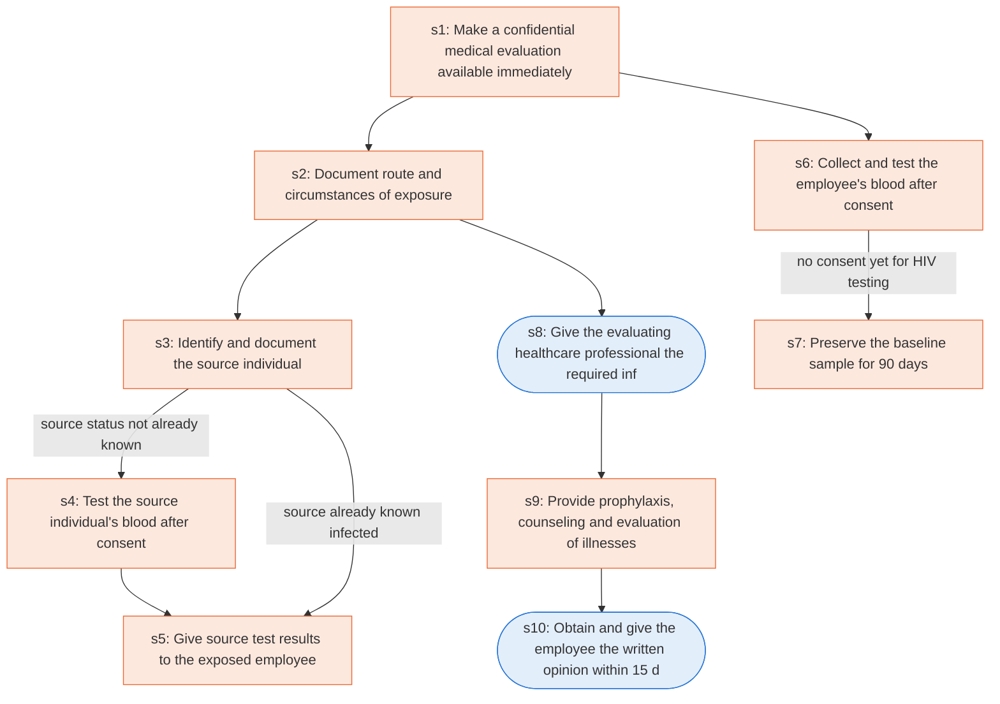

# Runbook: Bloodborne pathogens: post-exposure evaluation and follow-up

Source: 29 CFR 1910.1030(f)(3) to (f)(5) (OSHA), https://www.osha.gov/laws-regs/regulations/standardnumber/1910/1910.1030

Generated from the `gold` workflow spec. Rounded boxes are agent steps, square boxes are human steps.

| Step | Action | Owner | Executor | Hands to | Deadline | Source lines |
|---|---|---|---|---|---|---|
| s1 | Make a confidential medical evaluation available immediately | employer | human |  |  | L1 |
| s2 | Document route and circumstances of exposure | employer | human |  |  | L2 |
| s3 | Identify and document the source individual | employer | human |  |  | L3 |
| s4 | Test the source individual's blood after consent | employer | human |  |  | L4 |
| s5 | Give source test results to the exposed employee | employer | human | exposed employee |  | L6 |
| s6 | Collect and test the employee's blood after consent | employer | human |  |  | L7 |
| s7 | Preserve the baseline sample for 90 days | employer | human |  |  | L8 |
| s8 | Give the evaluating healthcare professional the required information | employer | agent | healthcare professional |  | L9 |
| s9 | Provide prophylaxis, counseling and evaluation of illnesses | healthcare professional | human |  |  | L10 |
| s10 | Obtain and give the employee the written opinion within 15 days | employer | agent | exposed employee | within 15 days of the completion of the evaluation | L11 |

## Handoffs

- **s5** employer to **exposed employee**: Give source test results to the exposed employee
- **s8** employer to **healthcare professional**: Give the evaluating healthcare professional the required information
- **s10** employer to **exposed employee**: Obtain and give the employee the written opinion within 15 days
