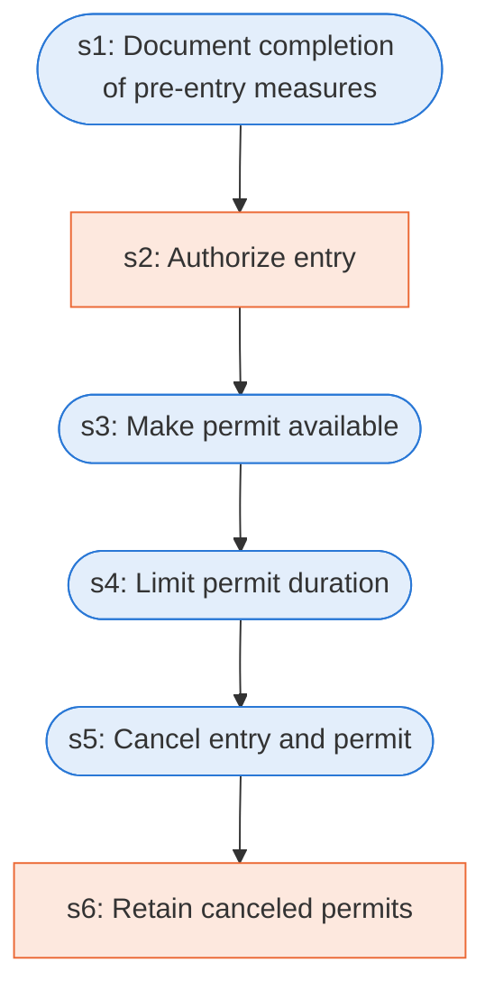

# Runbook: Permit-required confined spaces: permit system

Source: 29 CFR 1910.146(e) (OSHA), https://www.osha.gov/laws-regs/regulations/standardnumber/1910/1910.146

Generated from the `LLM-compiled` workflow spec. Rounded boxes are agent steps, square boxes are human steps.

| Step | Action | Owner | Executor | Hands to | Deadline | Source lines |
|---|---|---|---|---|---|---|
| s1 | Document completion of pre-entry measures | employer | agent |  |  | L1 |
| s2 | Authorize entry | entry supervisor | human |  |  | L2 |
| s3 | Make permit available | employer | agent | authorized entrants |  | L3 |
| s4 | Limit permit duration | employer | agent |  |  | L4 |
| s5 | Cancel entry and permit | entry supervisor | agent |  |  | L5 |
| s6 | Retain canceled permits | employer | human |  |  | L6 |

## Handoffs

- **s3** employer to **authorized entrants**: Make permit available
