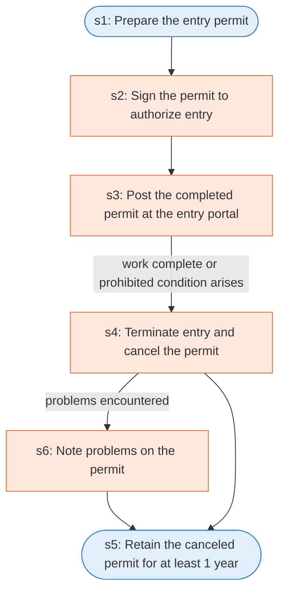

# Runbook: Permit-required confined spaces: permit system

Source: 29 CFR 1910.146(e) (OSHA), https://www.osha.gov/laws-regs/regulations/standardnumber/1910/1910.146

Generated from the `gold` workflow spec. Rounded boxes are agent steps, square boxes are human steps.

| Step | Action | Owner | Executor | Hands to | Deadline | Source lines |
|---|---|---|---|---|---|---|
| s1 | Prepare the entry permit | employer | agent |  |  | L1 |
| s2 | Sign the permit to authorize entry | entry supervisor | human |  |  | L2 |
| s3 | Post the completed permit at the entry portal | employer | human | authorized entrants |  | L3 |
| s4 | Terminate entry and cancel the permit | entry supervisor | human |  |  | L5 |
| s5 | Retain the canceled permit for at least 1 year | employer | agent |  |  | L6 |
| s6 | Note problems on the permit | employer | human |  |  | L7 |

## Handoffs

- **s3** employer to **authorized entrants**: Post the completed permit at the entry portal
