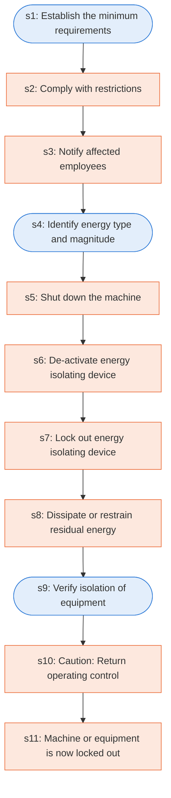

# Runbook: Typical minimal lockout procedure: sequence of lockout

Source: 29 CFR 1910.147 Appendix A (OSHA), https://www.osha.gov/laws-regs/regulations/standardnumber/1910/1910.147AppA

Generated from the `LLM-compiled` workflow spec. Rounded boxes are agent steps, square boxes are human steps.

| Step | Action | Owner | Executor | Hands to | Deadline | Source lines |
|---|---|---|---|---|---|---|
| s1 | Establish the minimum requirements | system | agent |  |  | L1 |
| s2 | Comply with restrictions | employee | human |  |  | L2 |
| s3 | Notify affected employees | authorized employee | human | affected employees |  | L3 |
| s4 | Identify energy type and magnitude | authorized employee | agent |  |  | L4 |
| s5 | Shut down the machine | authorized employee | human |  |  | L5 |
| s6 | De-activate energy isolating device | authorized employee | human |  |  | L6 |
| s7 | Lock out energy isolating device | authorized employee | human |  |  | L7 |
| s8 | Dissipate or restrain residual energy | authorized employee | human |  |  | L8 |
| s9 | Verify isolation of equipment | authorized employee | agent |  |  | L9 |
| s10 | Caution: Return operating control | authorized employee | human |  |  | L10 |
| s11 | Machine or equipment is now locked out | authorized employee | human |  |  | L11 |

## Handoffs

- **s3** authorized employee to **affected employees**: Notify affected employees
