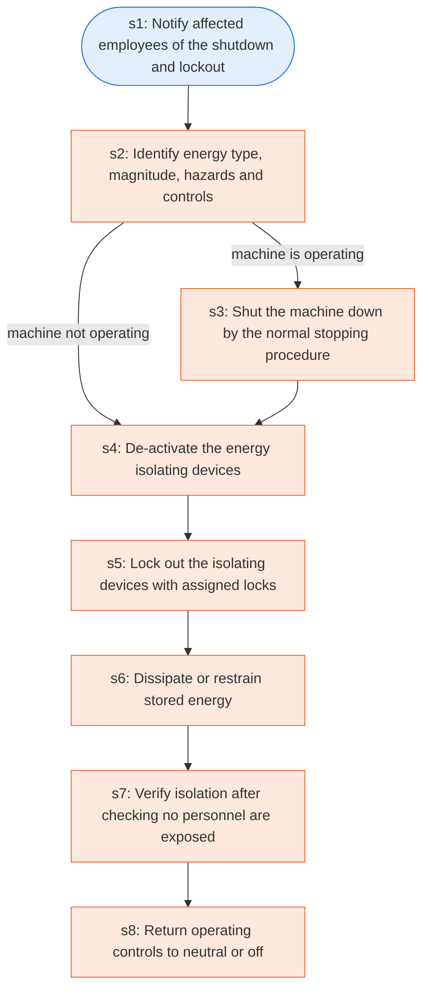

# Runbook: Typical minimal lockout procedure: sequence of lockout

Source: 29 CFR 1910.147 Appendix A (OSHA), https://www.osha.gov/laws-regs/regulations/standardnumber/1910/1910.147AppA

Generated from the `gold` workflow spec. Rounded boxes are agent steps, square boxes are human steps.

| Step | Action | Owner | Executor | Hands to | Deadline | Source lines |
|---|---|---|---|---|---|---|
| s1 | Notify affected employees of the shutdown and lockout | authorized employee | agent | affected employees |  | L3 |
| s2 | Identify energy type, magnitude, hazards and controls | authorized employee | human |  |  | L4 |
| s3 | Shut the machine down by the normal stopping procedure | authorized employee | human |  |  | L5 |
| s4 | De-activate the energy isolating devices | authorized employee | human |  |  | L6 |
| s5 | Lock out the isolating devices with assigned locks | authorized employee | human |  |  | L7 |
| s6 | Dissipate or restrain stored energy | authorized employee | human |  |  | L8 |
| s7 | Verify isolation after checking no personnel are exposed | authorized employee | human |  |  | L9 |
| s8 | Return operating controls to neutral or off | authorized employee | human |  |  | L10 |

## Handoffs

- **s1** authorized employee to **affected employees**: Notify affected employees of the shutdown and lockout
