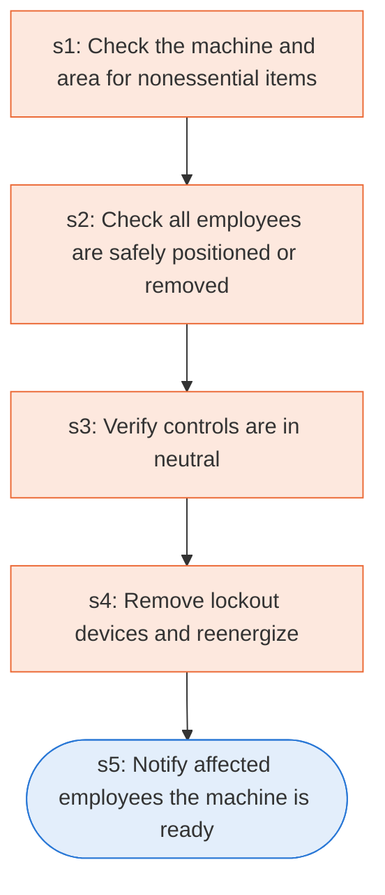

# Runbook: Typical minimal lockout procedure: restoring equipment to service

Source: 29 CFR 1910.147 Appendix A (OSHA), https://www.osha.gov/laws-regs/regulations/standardnumber/1910/1910.147AppA

Generated from the `gold` workflow spec. Rounded boxes are agent steps, square boxes are human steps.

| Step | Action | Owner | Executor | Hands to | Deadline | Source lines |
|---|---|---|---|---|---|---|
| s1 | Check the machine and area for nonessential items | authorized employee | human |  |  | L2 |
| s2 | Check all employees are safely positioned or removed | authorized employee | human |  |  | L3 |
| s3 | Verify controls are in neutral | authorized employee | human |  |  | L4 |
| s4 | Remove lockout devices and reenergize | authorized employee | human |  |  | L5 |
| s5 | Notify affected employees the machine is ready | authorized employee | agent | affected employees |  | L7 |

## Handoffs

- **s5** authorized employee to **affected employees**: Notify affected employees the machine is ready
