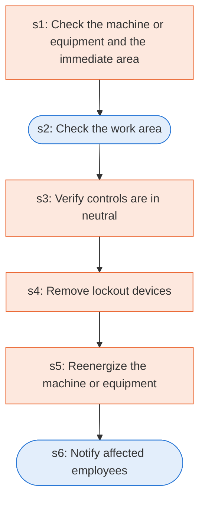

# Runbook: Typical minimal lockout procedure: restoring equipment to service

Source: 29 CFR 1910.147 Appendix A (OSHA), https://www.osha.gov/laws-regs/regulations/standardnumber/1910/1910.147AppA

Generated from the `LLM-compiled` workflow spec. Rounded boxes are agent steps, square boxes are human steps.

| Step | Action | Owner | Executor | Hands to | Deadline | Source lines |
|---|---|---|---|---|---|---|
| s1 | Check the machine or equipment and the immediate area | servicing personnel | human |  |  | L1 |
| s2 | Check the work area | servicing personnel | agent |  |  | L2 |
| s3 | Verify controls are in neutral | servicing personnel | human |  |  | L3 |
| s4 | Remove lockout devices | servicing personnel | human |  |  | L4 |
| s5 | Reenergize the machine or equipment | servicing personnel | human |  |  | L5 |
| s6 | Notify affected employees | servicing personnel | agent | affected employees |  | L6 |

## Handoffs

- **s6** servicing personnel to **affected employees**: Notify affected employees
