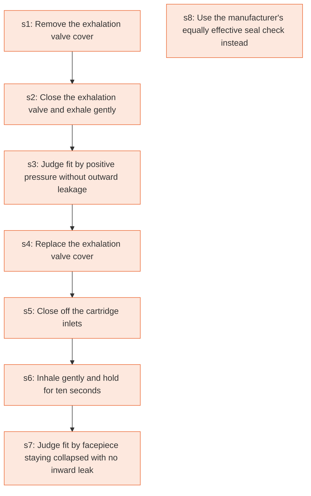

# Runbook: Respirator user seal check procedures

Source: 29 CFR 1910.134 Appendix B-1 (OSHA), https://www.osha.gov/laws-regs/regulations/standardnumber/1910/1910.134AppB1

Generated from the `gold` workflow spec. Rounded boxes are agent steps, square boxes are human steps.

| Step | Action | Owner | Executor | Hands to | Deadline | Source lines |
|---|---|---|---|---|---|---|
| s1 | Remove the exhalation valve cover | respirator user | human |  |  | L3 |
| s2 | Close the exhalation valve and exhale gently | respirator user | human |  |  | L4 |
| s3 | Judge fit by positive pressure without outward leakage | respirator user | human |  |  | L5 |
| s4 | Replace the exhalation valve cover | respirator user | human |  |  | L6 |
| s5 | Close off the cartridge inlets | respirator user | human |  |  | L7 |
| s6 | Inhale gently and hold for ten seconds | respirator user | human |  |  | L8 |
| s7 | Judge fit by facepiece staying collapsed with no inward leakage | respirator user | human |  |  | L9 |
| s8 | Use the manufacturer's equally effective seal check instead | respirator user | human |  |  | L10 |

## Handoffs

- none
