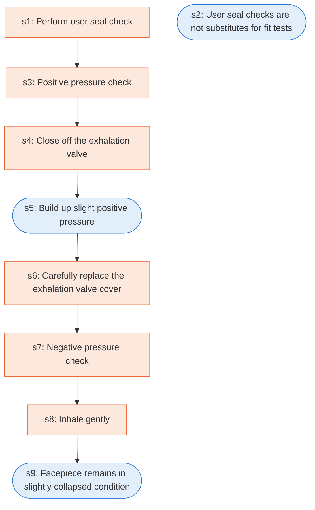

# Runbook: Respirator user seal check procedures

Source: 29 CFR 1910.134 Appendix B-1 (OSHA), https://www.osha.gov/laws-regs/regulations/standardnumber/1910/1910.134AppB1

Generated from the `LLM-compiled` workflow spec. Rounded boxes are agent steps, square boxes are human steps.

| Step | Action | Owner | Executor | Hands to | Deadline | Source lines |
|---|---|---|---|---|---|---|
| s1 | Perform user seal check | individual who uses a tight-fitting respirator | human |  |  | L1 |
| s2 | User seal checks are not substitutes for fit tests | individual who uses a tight-fitting respirator | agent |  |  | L2 |
| s3 | Positive pressure check | individual who uses a tight-fitting respirator | human |  |  | L3 |
| s4 | Close off the exhalation valve | individual who uses a tight-fitting respirator | human |  |  | L4 |
| s5 | Build up slight positive pressure | individual who uses a tight-fitting respirator | agent |  |  | L5 |
| s6 | Carefully replace the exhalation valve cover | individual who uses a tight-fitting respirator | human |  |  | L6 |
| s7 | Negative pressure check | individual who uses a tight-fitting respirator | human |  |  | L7 |
| s8 | Inhale gently | individual who uses a tight-fitting respirator | human |  |  | L8 |
| s9 | Facepiece remains in slightly collapsed condition | individual who uses a tight-fitting respirator | agent |  |  | L9 |

## Handoffs

- none
