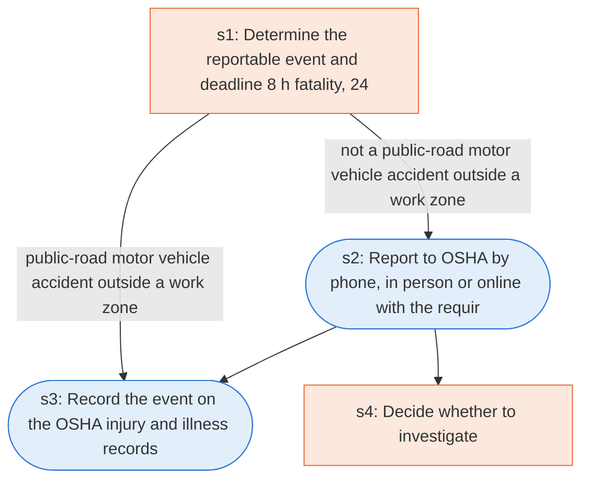

# Runbook: Reporting fatalities, hospitalizations, amputations, and losses of an eye to OSHA

Source: 29 CFR 1904.39 (OSHA), https://www.osha.gov/laws-regs/regulations/standardnumber/1904/1904.39

Generated from the `gold` workflow spec. Rounded boxes are agent steps, square boxes are human steps.

| Step | Action | Owner | Executor | Hands to | Deadline | Source lines |
|---|---|---|---|---|---|---|
| s1 | Determine the reportable event and deadline (8 h fatality, 24 h hospitalization, amputation, eye loss) | employer | human |  | Within eight (8) hours after the death of any employee as a result of a work-related incident; Within twenty-four (24) hours after the in-patient hospitalization of one or more employees or an employee's amputation or an employee's loss of an eye | L1, L2 |
| s2 | Report to OSHA by phone, in person or online with the required details | employer | agent | OSHA |  | L3, L4, L5 |
| s3 | Record the event on the OSHA injury and illness records | employer | agent |  |  | L7 |
| s4 | Decide whether to investigate | OSHA Area Office director | human |  |  | L8 |

## Handoffs

- **s2** employer to **OSHA**: Report to OSHA by phone, in person or online with the required details
