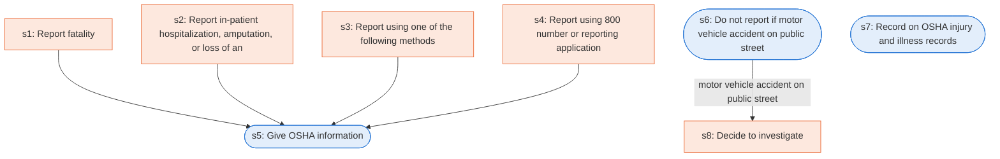

# Runbook: Reporting fatalities, hospitalizations, amputations, and losses of an eye to OSHA

Source: 29 CFR 1904.39 (OSHA), https://www.osha.gov/laws-regs/regulations/standardnumber/1904/1904.39

Generated from the `LLM-compiled` workflow spec. Rounded boxes are agent steps, square boxes are human steps.

| Step | Action | Owner | Executor | Hands to | Deadline | Source lines |
|---|---|---|---|---|---|---|
| s1 | Report fatality | employer | human | OSHA | Within eight (8) hours after the death of any employee as a result of a work-related incident | L1 |
| s2 | Report in-patient hospitalization, amputation, or loss of an eye | employer | human | OSHA | Within twenty-four (24) hours after the in-patient hospitalization of one or more employees or an employee's amputation or an employee's loss of an eye | L2 |
| s3 | Report using one of the following methods | employer | human | OSHA |  | L3 |
| s4 | Report using 800 number or reporting application | employer | human | OSHA |  | L4 |
| s5 | Give OSHA information | employer | agent |  |  | L5 |
| s6 | Do not report if motor vehicle accident on public street | employer | agent |  |  | L6 |
| s7 | Record on OSHA injury and illness records | employer | agent |  |  | L7 |
| s8 | Decide to investigate | OSHA | human | local Area Office director |  | L8 |

## Handoffs

- **s1** employer to **OSHA**: Report fatality
- **s2** employer to **OSHA**: Report in-patient hospitalization, amputation, or loss of an eye
- **s3** employer to **OSHA**: Report using one of the following methods
- **s4** employer to **OSHA**: Report using 800 number or reporting application
- **s8** OSHA to **local Area Office director**: Decide to investigate
